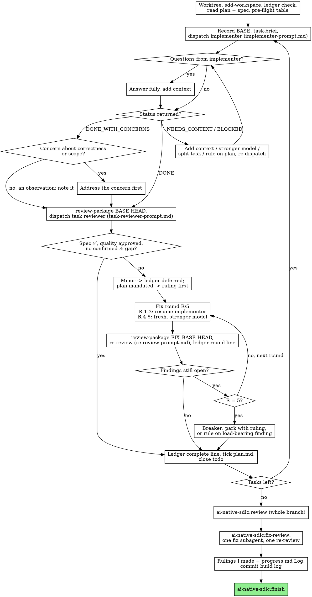

# Build: background and long-form guidance

Companion to `SKILL.md` in this folder. SKILL.md is the procedure; this file explains why it is shaped that way and carries the material too long to keep there.

## Why a controller and subagents

Each implementer starts with an empty context that you assemble on purpose: the brief, the interfaces it touches, the constraints that bind it. It never inherits your session or its history, so it stays on its one task. Your own context stays free for coordination: the ledger, rulings, review packages.

The formula: a fresh implementer for every task, a scoped two-verdict review after each one, a single broad review at the end. Quality comes from the reviews; speed comes from never waiting on a human between tasks.

### build compared with run

| | build | run |
|---|---|---|
| Who writes code | a new subagent per task, so contexts never mix | you, in one context, task after task |
| When review happens | after every task (spec + quality), plus once at the end | one reviewer at the end |
| Cost | a fresh context per task and per review | one context plus the final reviewer |
| Shared | same plan workspace, same ledger, no pausing between tasks | same |

## Flow



## Choosing models in depth

Work through these questions for each dispatch. Stop at the first one that settles the tier.

| Ask | If yes |
|---|---|
| Is this the final whole-branch review, or does the task call for architecture, design judgment, or a wide grasp of the codebase? | most capable |
| Is this fix round 4 or 5? | at least one tier above the model the stuck implementer used |
| Does the plan text already hold the complete code, so the implementer only transcribes and tests? Or is it a fix inside one file? | cheapest |
| Is it an implementation in one or two files with a spec that leaves nothing open? (Well-written plans turn most tasks into this.) | cheap |
| Does it coordinate several files, follow existing patterns across modules, or involve debugging? | standard |
| Is it a scoped re-review of a small fix diff? | cheap to mid |
| Is it a task review? | size it to the diff's risk, never below mid-tier |
| Is it an implementation described only in prose? | mid-tier at minimum |

**Why mid-tier is a floor.** What you pay is driven by how many turns a subagent spends, not by its price per token. Given multi-step work, the bottom tier tends to burn two to three times the turns, and the bill ends up higher than a mid model's. Reviewers and prose-driven implementers therefore never drop below mid.

**Sizing a review, by example.** A diff that renames a config key across four YAML files is low risk: mid-tier reads it fine. A diff that changes how two workers acquire a shared file lock can fail in ways only careful reasoning catches, so it goes to the top tier even if it is twenty lines.

**Never leave the field blank.** A subagent dispatched with no model takes the session's own, usually the dearest one available, and every choice above is quietly undone. The aim throughout is the least capable model that still does the role well, because that is cheaper and usually faster.

## Why the rules look like this

- **The ledger.** Compaction erases conversation memory. The costliest failure seen in practice was a controller that forgot where it was and re-dispatched a whole run of finished tasks. Commits named in the ledger exist in git whether or not you remember making them.
- **Rulings over questions.** Your human partner can spot and undo a bad call when they read the ledger. A controller that sits waiting for an answer delivers nothing at all until they come back, which may be the next morning.
- **Pre-flight as a table.** Saying "scan clean" without per-pair and per-task rows means the scan was not actually done. The task review still catches conflicts that only show up during implementation.
- **Small dispatches.** Whatever you paste into a prompt, and whatever a subagent prints back, stays in your context and is re-read every turn. One real dispatch reached 42k characters, nearly all of it pasted history from earlier tasks. Exact values live only in the brief so there is a single source of truth.
- **No subagents inside implementers.** Each reviewer a worker spawned for itself duplicated the controller's own task review: a whole extra review seat per task.
- **BASE, never `HEAD~1`.** A task often lands in several commits; `HEAD~1` would show the reviewer only the last one. Without bash, build the same package by hand: `git log --oneline`, `git diff --stat` and `git diff -U10` for the range, redirected into one uniquely named file, so it never passes through your context.
- **The constraints block.** It is the reviewer's lens for what this project specifically demands. Generic process rules (YAGNI, test hygiene, review method) are in the template already.
- **⚠️ items.** They do not hold up the rest of the review; you clear them because only you hold the plan and the cross-task picture.
- **Deferred minors.** A summary nobody reads is a silent discard, which is why the final review is pointed at the list.
- **Fresh implementer at round 4.** Surviving three resumes usually means the implementer cannot see its own mistake. New eyes and a stronger model fix both at once.
- **The controller does not fix.** Fixes made by you skip review and fill your context.
- **Breaker only at the cap.** Closing findings by verdict in round two or three, just to get out of the loop, has the same effect as telling the reviewer not to flag them. Parking a structural failure without a word lets every later task build on it.
- **One final fix wave.** A fixer per finding rebuilds context and re-runs suites each time; in one real session that wave cost more than every task together.
- **Rulings I made.** Your human partner never reads the ledger; finish deletes it. The final list is how they learn what you decided for them and where to send rework. A ruling missing from that list is one they will never get to question.
- **Bounded waits.** A short-timeout poll wastes turns; one endless silent wait hides a lost child until the session ends. Five-to-ten-minute stretches keep almost all the efficiency and surface a stuck child within minutes.

## Excuses to catch in yourself

Grouped by where in the loop they tend to show up.

| Phase | The thought | The answer |
|---|---|---|
| Implementation | "My subagent ran a reviewer of its own, so this task is double-checked." | That second reviewer is waste: it repeats the gate you are about to run. Report it as a defect in the worker. |
| Review | "Two requirements are missing but the rest is great; call it done." | Missing requirements keep the task open. The exits are a fix, or the round-5 breaker with a written ruling. |
| Review | "Each review adds minutes; let me skip this one." | Unreviewed fixes produce the churn the reviews exist to stop; every task and every round gets its review. |
| Fix loop | "I can see the bug, I will just edit the line." | Send it back to the implementer. An edit by you is never reviewed and leaves debris in the context you need for coordination. |
| Fix loop | "That Important finding is nonsense, I will close it." | Not before round 5, and never without a ledger line. Until then the finding stays in the loop. |
| Fix loop | "The change in this round was one character; re-review is overkill." | Small fixes break things too. A round is not over until its scoped re-review is back. |
| Fix loop | "If I re-review, they will find something new to complain about." | The re-review only looks at the fix diff. Remarks about other code become deferred minors in the ledger and do not reopen the loop. |
| Cap | "Round five failed, but a sixth will get there." | Five failed rounds point at something structural. Trip the breaker: park with rulings or rule on the load-bearing finding. |
| Bookkeeping | "I remember which tasks are done; the ledger can wait." | After compaction you will not. The ledger is the only record that survives it, and without it you re-dispatch finished work. |

## A sample session

```text
Controller: Running build on sdlc/changes/2026-03-02-csv-export/plan.md.

[worktree confirmed]
[sdd-workspace -> .ai-sdlc/sdd/2026-03-02-csv-export/ ; no ledger, start fresh]
[ledger line 1 written; plan and spec read; 3 todos]
[pre-flight table: Task 1 produces formatRow(), Task 2 consumes it - signatures agree]

Task 1: row formatter
[BASE=3e1f0aa; task-brief 1; implementer dispatched on cheap tier with brief + report paths]
Implementer: "Quote every field, or only fields containing commas?"
Controller: "Only fields containing a comma, quote or newline, per spec R2."
Implementer: DONE. 2 commits, 7/7 tests pass.
[review-package BASE HEAD -> review-3e1f0aa..9b4c210.diff; reviewer on mid tier]
Reviewer: ✅ spec compliant; quality Approved, nothing to fix.
[ledger: Task 1: complete (commits 3e1f0aa..9b4c210, review clean); plan.md ticked]

Task 2: export endpoint
[BASE=9b4c210; task-brief 2; implementer dispatched on standard tier]
Implementer: DONE. 1 commit, 11/11 tests pass.
Reviewer: ❌ header row missing when result set is empty.
  Important: Content-Disposition filename not sanitized.
  Important: no test for a field that contains a newline.
[fix round 1: resume implementer with all three findings, naming tests/export.test.mjs]
Implementer: all three fixed, test file re-run 14/14, fix report appended.
[review-package FIX_BASE HEAD; re-review on cheap tier]
Re-reviewer: header row - ADDRESSED; filename - ADDRESSED; newline test - ADDRESSED; no new breakage.
[ledger: Task 2: fix round 1/5 (3 addressed, 0 open; commits 9b4c210..c07d5e1)]
[ledger: Task 2: complete (commits 9b4c210..c07d5e1, review clean)]

... Task 3 ...

[ai-native-sdlc:review on most capable model -> review.md, no blocking findings]
[Rulings I made: none. Log appended, commit sdlc(csv-export): build log]
Controller: handing over to ai-native-sdlc:finish.
```
