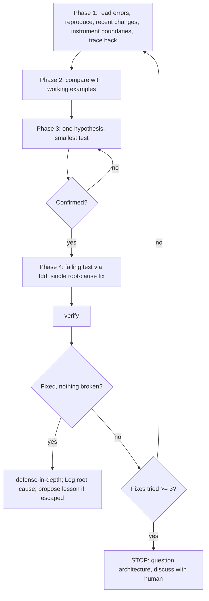

# Debugging by root cause

Find out why a thing breaks before you change anything, then fix it once, at the place the fault starts.

## When to use

- Any technical problem: a red test, a production bug, behavior that surprises someone, a slow path, a broken build, two systems that do not talk to each other properly.
- Above all in the moments that tempt you to skip it: a deadline or an outage, a fix that looks obvious, a fix that already failed, several attempts already made, a problem you only half understand.
- Also when the problem looks small, when you are short of time, and when someone is pushing for the fix right now. Small bugs still have a cause. Guessing under pressure costs more time than looking.
- Several failures with no shared cause (three test files red for three different reasons, say): run `parallel` first. It gives each failure its own investigation, and every one of those investigations follows this skill.

Inputs: the error output and stack traces, `git diff` and the recent commits, code that works next to code that does not. Supporting material in this folder: [root-cause-tracing.md](root-cause-tracing.md), [defense-in-depth.md](defense-in-depth.md), [condition-based-waiting.md](condition-based-waiting.md) with its code sample [condition-based-waiting-example.ts](condition-based-waiting-example.ts), and the script `find-polluter.sh`.

## Steps



The rule every phase serves:

```
NO FIXES WITHOUT ROOT CAUSE INVESTIGATION FIRST
```

Until Phase 1 is finished you have no fix to offer, only guesses. Keeping to the wording of this process while skipping what it is for is the same as ignoring it. The four phases run in order; do not start one before the previous one is done. A patch that only hides the symptom counts as a failure, even when the test turns green.

### Phase 1: find where and why it breaks

Do these in order. Each one depends on what the previous one showed you.

1. **Read everything the failure printed.** Read the whole stack trace, every warning, and every error code. Write down the file paths and line numbers. The answer is often printed right there, and people scroll past it.
2. **Make it happen on demand.** Write down the exact steps. Run them several times: does it fail every time, or only sometimes? If you cannot reproduce it, collect more data (logs, inputs, timing, environment). Do not guess at a fix for a failure you cannot trigger.
3. **Ask what changed.** Read `git diff` and `git log` for the area. Look for new or bumped dependencies, edited config, and differences between the machine where it works and the one where it fails.
4. **If the data crosses several components, instrument the seams before you theorise.** At every hand-off (job to build, build to container, service to queue to worker, and so on) log what goes in, what comes out, and whether the environment and config arrived intact. Also check the state at each layer. Run it once. The logs show which seam drops or corrupts the data. Investigate that component and leave the others alone.

   Say a deploy pipeline loses a token on its way into the app:

   ```bash
   # seam 1: the CI job, before it starts the image build
   echo "[ci] PAYMENTS_TOKEN: $([ -n "${PAYMENTS_TOKEN:-}" ] && echo present || echo missing)"
   # seam 2: inside the image build
   docker build --build-arg PAYMENTS_TOKEN --progress=plain -t shop:debug . 2>&1 | grep '\[build\]'
   # seam 3: the environment the running container sees
   docker run --rm shop:debug sh -c 'echo "[container] PAYMENTS_TOKEN: ${PAYMENTS_TOKEN:+present}"'
   # seam 4: what the application actually loaded
   docker run --rm shop:debug node -e 'console.log("[app] token loaded:", Boolean(require("./config").paymentsToken))'
   ```

   If seams 1 and 2 print "present" and seam 3 prints nothing, the token is lost between build time and run time. That boundary is what you investigate next. You do not touch the application code yet.
5. **If the error surfaces deep in a call chain, walk backwards.** Ask where the bad value came from and which caller passed it in. Keep climbing until you reach the place that first produced it, and fix it there, not where it blew up. The full method (symptom, immediate cause, each caller in turn, the bad value, the original trigger), the stack-capture instrumentation for chains you cannot follow by reading, and the `find-polluter.sh` bisection for a test that leaves files or state behind are all in [root-cause-tracing.md](root-cause-tracing.md).

You are done with Phase 1 when you can say what fails and why.

### Phase 2: compare with what works

1. Find code in the same repo that does something similar and does work.
2. If you are following a pattern or a reference implementation, read the whole reference, every line, before you apply it. Do not skim it.
3. List every difference between the working version and the broken one, including the ones that look trivial. Do not rule a difference out because you assume it cannot matter.
4. Write down what the broken code depends on: other components, settings, config, the environment, and the assumptions it makes about each of them.

You are done with Phase 2 when you have a list of differences.

### Phase 3: test one idea at a time

1. Write one hypothesis down, specific enough to be wrong: "the token disappears because the Dockerfile declares it as `ARG` and never copies it into `ENV`". "Something in the config" is not a hypothesis.
2. Test it with the smallest change that could confirm or refute it. Change one variable only. Never test two ideas in one run.
3. Read the result:

| Result | Next move |
|---|---|
| The hypothesis held | Go to Phase 4 |
| It did not hold | Form a new hypothesis from what you learned. Never pile a second change on top of the first |
| You cannot tell, or you are out of ideas | Say it plainly ("I don't understand how X gets its value"). Research it, or ask your human partner. Do not pretend to know |

### Phase 4: fix at the source

1. **A failing test comes first.** Write the smallest reproduction of the bug as an automated test. If the project has no test framework, a throwaway script that fails is enough. This test must exist and fail before you change any code. Write it with `ai-native-sdlc:tdd`.
2. **One fix.** Change the root cause you confirmed, and nothing else. No refactoring along the way, no "while I'm here" tidy-ups.
3. **Check it.** The new test passes, the rest of the suite still passes, and the original problem is actually gone. Run `ai-native-sdlc:verify` before you say it is fixed.

### When the fix does not hold

Stop, and count how many fixes you have tried for this bug.

- **Fewer than three:** go back to Phase 1 and start again, using what this failure taught you.
- **Three or more:** stop fixing. This is no longer a wrong hypothesis. The design itself is probably wrong. The usual signs: every fix uncovers more shared state or coupling somewhere else, the next fix would need a large refactor, and each fix makes something else break. Ask whether the pattern is sound at all, and whether the team is keeping it only because it is already there. Should the structure change, rather than one more symptom being patched? Discuss this with your human partner. Do not make fix number four until you have.

### When there seems to be no root cause

Sometimes a complete investigation shows the cause really is outside the code: the environment, timing, or an external system. This is rare: about 95% of "no root cause" verdicts turn out to be an investigation that stopped too early. When the verdict is genuine, the process is complete:

1. Write down what you investigated and what you ruled out.
2. Add handling that fits the cause: a retry, a timeout, a clear error message.
3. Add monitoring or logging, so that the next occurrence brings evidence with it.

### After the fix

- **Make it impossible, not just fixed.** Add checks at every layer the bad data passed through: validation at the entry point, validation in the business logic, environment guards, and debug instrumentation. See [defense-in-depth.md](defense-in-depth.md).
- **If timing was involved,** replace sleeps and fixed delays in the tests with waits on the real condition. A fixed delay stays only where the test is about timing itself. See [condition-based-waiting.md](condition-based-waiting.md).
- **In a harness repo,** when the bug comes up while you are building a change, record its root cause in the Log entry of that change's progress.md. If the bug got past review or happened in production, propose `ai-native-sdlc:lesson` once the fix is in.

## Rules

Each rule below names the thought or remark that breaks it. When you notice one of them, stop and go back to Phase 1.

### Investigate before you fix (Iron Law, Phase 1)

- Do not offer a fix you cannot explain. "It's probably the cache, let me clear it" is a guess.
- Do not fix now and plan to investigate later. "Later" never comes once the symptom is quiet, and every patch after that is built on a guess. The same applies when it is an emergency: an outage gives you no time for three wrong patches, and tracing the cause once costs less than shipping them.
- Do not skip the process because the problem looks simple. A one-line bug still came from somewhere, and when the problem really is small the four phases take a few minutes.
- Do not list fixes before you have traced the data. A list of "the main problems" with a fix next to each one, written before any tracing, breaks this rule.
- Knowing where it fails is not knowing why. A visible symptom is not a diagnosis.

### Learn from working code (Phase 2)

- Do not adapt a pattern you have only skimmed. "The reference is long, I'll adjust it as I go" brings in the bugs the reference already solved. Read all of it first.

### One idea at a time (Phase 3)

- Do not change something to see what happens. "Let me just flip this flag and rerun" is not a test.
- Do not batch changes. If three edits go in together and the test passes, you cannot tell which one fixed it, and the other two may have broken something else.

### Test first, one fix (Phase 4)

- Do not skip the regression test and check by hand instead. A manual check vanishes the moment you close the terminal, and nothing then stops the next refactor from bringing the bug back. A test you saw fail before the fix is your proof that you reproduced the right bug.
- Do not keep a fix that "might work" when you cannot say why it would.
- After two failed fixes, do not reach for "one more attempt" without going back to Phase 1. When every fix uncovers a problem in a new place, the design is the problem. See "When the fix does not hold".

### What your human partner says

If your partner says something like the following, treat it as a redirect and go back to Phase 1:

| Your partner says | What it tells you |
|---|---|
| "Is that not happening?" | A fact you relied on was never confirmed; go and observe it |
| "Will it show us...?" | Your partner wants logs or output that settle it, and you jumped past them |
| "Stop guessing" | Your fixes are running ahead of your diagnosis |
| "Ultra-think this" | Step back from the failing line and doubt the assumptions underneath it |
| "We're stuck?" (frustrated) | Patience with the current line of attack has run out; change the method, not the next patch |

## Output and handoff

What this skill leaves behind: a failing regression test that now passes, a single fix at the root cause, and, in a harness repo, a Log entry in progress.md that names the root cause. It does not require any particular commit message, and it does not dispatch subagents.

Handoffs: `ai-native-sdlc:tdd` writes the failing test in Phase 4. `ai-native-sdlc:verify` runs before you claim the fix works. `ai-native-sdlc:lesson` is proposed when the bug escaped review or reached production. `parallel` comes before this skill when several unrelated failures arrive together.

| Phase | Done when |
|---|---|
| 1. Root cause | You can say what fails and why |
| 2. Pattern | You have a list of differences from a working example |
| 3. Hypothesis | One hypothesis is confirmed, or a new one replaces it |
| 4. Fix | The regression test passes, the suite is green, the problem is gone |
