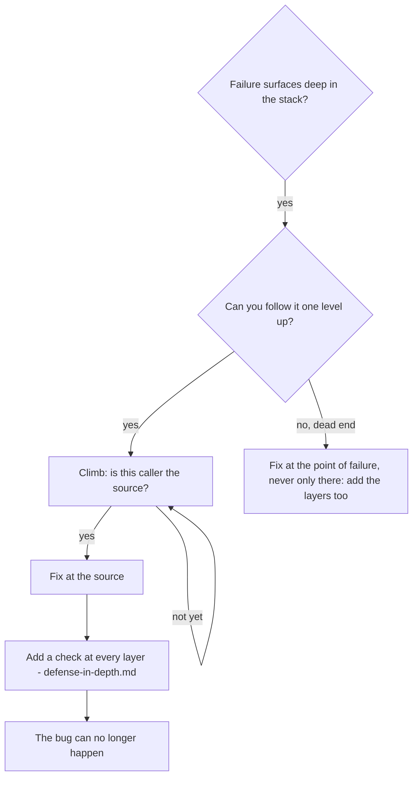

# Tracing a failure back to its trigger

Where an error surfaces is rarely where it started. A receipt shows the wrong total, an email reaches the wrong customer, a test run leaves rows in a database it should never touch: the line that misbehaves is usually just the last one in a chain that took a bad value from much further up. If you patch that last line, you have treated a symptom. Follow the chain upwards until you reach the code that first produced the bad value, and fix it there.

## Decide whether to trace

Trace when the failure happens far from any entry point, the stack trace is long, nobody knows where the bad data came from, or you still have to find out which test or code path sets it off.



Once you can trace, you do not settle for the symptom. Only a real dead end, with no caller left to inspect and no instrumentation that reveals one, justifies a fix where the error appears. Even then, the layered checks go in as well.

## The climb, step by step

The running example: after every run of the integration tests, a developer's local database contains new users called `signup-test-…`. The tests were supposed to use a separate `shop_test` database.

1. **Write down the symptom exactly as it appears.** After `npm test`, `SELECT count(*) FROM users WHERE email LIKE 'signup-test-%'` against `shop_dev` grows by four.
2. **Find the line that does the damage directly.**
   ```typescript
   await this.pool.query('INSERT INTO users (email, name) VALUES ($1, $2)', [email, name]);
   ```
3. **Ask who called it, and keep asking.**
   ```text
   UserRepo.create()
     <- SignupService.register()
     <- POST /signup handler in routes/signup.ts
     <- request(app).post('/signup') in tests/signup.test.ts
   ```
4. **At each level, look at the value that was passed down.** The query is fine. The `pool` it runs on is the suspect. It was opened with a connection string that names `shop_dev`, so every layer above handed on a pool that pointed at the wrong database.
5. **Find the line that first created the bad value.**
   ```typescript
   // src/db.ts, evaluated the moment anything imports it
   export const pool = new Pool({ connectionString: process.env.DATABASE_URL });
   ```
   `tests/signup.test.ts` imports `app` on line 1. That import pulls in `db.ts`, which reads `DATABASE_URL` from the developer's `.env`. The helper that switches `DATABASE_URL` to `shop_test` is only called on line 4, after the pool already exists.

That import-time read, which happens before the test environment is in place, is the original trigger. The fix belongs there: the test environment is set in the runner's setup file, which executes before any test file is imported. The `INSERT` line stays as it is.

## When reading the code is not enough

If you cannot follow the chain by reading it (callbacks, dependency injection, dynamic dispatch, module load order), make the program report its own call path. Put the logging just before the risky operation, so that it prints even if the operation then crashes:

```typescript
export function openPool(url = process.env.DATABASE_URL) {
  console.error('TRACE openPool', {
    database: url ? new URL(url).pathname : '(unset)',
    cwd: process.cwd(),
    env: process.env.NODE_ENV,
    at: new Date().toISOString(),
    stack: new Error().stack,
  });
  return new Pool({ connectionString: url });
}
```

```bash
npm test 2>&1 | grep -A 20 'TRACE openPool'
```

- In tests, use `console.error`. The app's logger is often silenced or redirected during test runs, and your evidence would disappear with it.
- Log before the operation, not in a catch block after it has failed.
- Include the context that could explain the value: the argument itself, the working directory, the relevant environment variables, and a timestamp.
- `new Error().stack` gives you the whole call chain without throwing anything.

When you read the output, look for test file names in the stacks and the line in each one that started the call. Then look for what the bad calls have in common: the same test file, the same argument, the same setup helper. In the example, every stack ran through `tests/signup.test.ts:1`, and the timestamps put each pool's creation ahead of the environment helper.

## When a test leaves something behind and you do not know which one

If an artifact (a stray `.git`, a lock file, a folder) appears somewhere during the suite and no single test obviously creates it, bisect the suite with the script in this folder:

```bash
bash ./find-polluter.sh '.git' 'src/**/*.test.ts'
```

The first argument is the file or directory to watch for, the second is a glob for the test files. The script runs the matching test files one at a time and stops at the first one after which the artifact exists. The usage notes are in the script's header.

## How the example ended

- The chain went five levels: the `INSERT`, `UserRepo`, `SignupService`, the route handler, and finally the import-time pool in `db.ts`, which the test file loaded before setting its environment.
- The fix went in at the source: the test environment moved into the runner's setup file, so `DATABASE_URL` names `shop_test` before any module loads.
- Checks were added along the path as well: `openPool` refuses an unset URL, under `NODE_ENV=test` it refuses any database whose name does not end in `_test`, and the trace line stays in front of the pool's creation. [defense-in-depth.md](defense-in-depth.md) explains why each of these layers is needed.
- After that the suite passed, and `shop_dev` stopped gaining test users.
