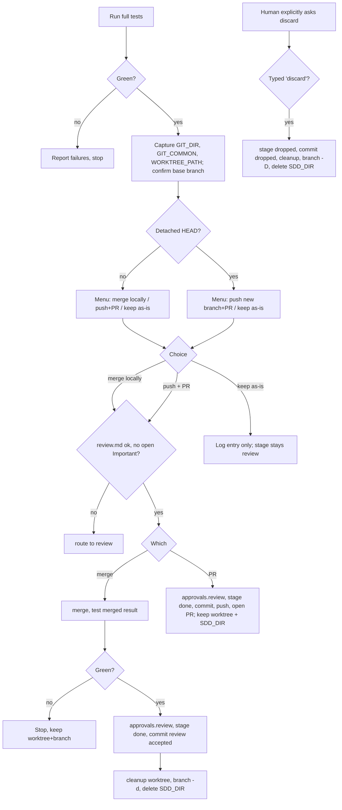

# Finish

Close out a finished branch: prove it is green, let your human partner choose how it lands, record that choice in progress.md, and tidy up only what this plugin created.

## When to use

- The plan's tasks are done, the suite passes, and the open question is how the branch gets integrated: merged here, sent as a pull request, parked, or thrown away.
- Not for checking whether a fix works and not for a routine commit. Those go through `ai-native-sdlc:verify`.
- First words: "I'm using the finish skill to complete this work."

Inputs: the test command (`verify.test` in `sdlc/config.json` for a harness repo), the git directory state, `sdlc/changes/<slug>/review.md`, the change's SDD workspace, and the ledger's Rulings and deferred minor findings.

## Steps



### 1. Run the whole suite

Use the project's full test command (`npm test`, `cargo test`, `pytest`, `go test ./...`, or `verify.test` in a harness repo). Any failure ends the skill here, with no menu, until the suite is green again:

```
Tests failing (<N> failures). Must fix before completing:

[Show failures]
```

### 2. Capture the environment

Record these values now, from inside the workspace. Later steps change directory to the main repo root, and cleanup needs the values from before that move:

```bash
GIT_DIR=$(cd "$(git rev-parse --git-dir)" 2>/dev/null && pwd -P)
GIT_COMMON=$(cd "$(git rev-parse --git-common-dir)" 2>/dev/null && pwd -P)
WORKTREE_PATH=$(git rev-parse --show-toplevel)
```

| Where you are | Menu shown | Workspace cleanup |
|---|---|---|
| ordinary checkout (`GIT_DIR` equals `GIT_COMMON`) | three options | nothing to remove |
| linked worktree on a named branch | three options | depends on who created it (step 7) |
| linked worktree on a detached HEAD | two options, merge not offered | the host manages it; leave it alone |

Also locate the change's SDD workspace with `bash ../build/scripts/sdd-workspace <PLAN_FILE>`, where PLAN_FILE is `sdlc/changes/<slug>/plan.md` (bounded change: `sdlc/changes/<slug>/progress.md`). Keep the printed path as `SDD_DIR`. Never type that path by hand.

### 3. Pin down the base branch

| Source to check, in order | Example of what you find |
|---|---|
| the plan | "branch off `release/2.4`" |
| this session's conversation | "base it on develop" |
| the branch's upstream | `git rev-parse --abbrev-ref @{upstream}` names `origin/main` |

Found nothing? Ask: "This branch split from <your best guess> - is that correct?" Either way, the base is confirmed before any merge runs.

### 4. Show the menu and wait

Ordinary checkout or named-branch worktree, word for word:

```
Implementation complete. What would you like to do?

1. Merge back to <base-branch> locally
2. Push and create a Pull Request
3. Keep the branch as-is (I'll handle it later)

Which option?
```

Detached HEAD, word for word:

```
Implementation complete. You're on a detached HEAD (externally managed workspace).

1. Push as new branch and create a Pull Request
2. Keep as-is (I'll handle it later)

Which option?
```

Add no options, explanations or suggestions. Discarding is never on the menu; it exists only as an answer to your partner explicitly asking for it (step 6, Discard). Then wait for their pick.

### 5. Gate before recording a review

Talk about outcomes by name, never by number, because the two menus number them differently: merge locally / push + PR / keep as-is / discard.

Merge locally and push + PR both set `approvals.review`. Before setting it, check that `sdlc/changes/<slug>/review.md` exists (bounded change: the review section in progress.md) and that none of its Important rows is still `open`. The only exception is your partner explicitly accepting an open row; write that acceptance in the Log. If review.md is missing or has open Important rows, go to `ai-native-sdlc:review` instead of continuing.

Record each outcome only inside its own branch below, at the moment it happens.

### 6. Carry out the outcome

| Outcome | progress.md | Commit | Branch | Worktree | `SDD_DIR` |
|---|---|---|---|---|---|
| merge locally | `approvals.review`, `stage: done`, Log | `sdlc(<slug>): review accepted` | deleted with `-d` | removed (step 7) | deleted after cleanup succeeds |
| push + PR | `approvals.review`, `stage: done`, Log | `sdlc(<slug>): review accepted` | kept, pushed | kept | kept |
| keep as-is | Log only; `stage` stays `review` | none | kept | kept | kept |
| discard | `stage: dropped`, reason in Log | `sdlc(<slug>): dropped` | deleted with `-D` | removed (step 7) | deleted |

**Merge locally.** Move to the main repo root, then merge before touching anything else:

```bash
MAIN_ROOT=$(git -C "$(git rev-parse --git-common-dir)/.." rev-parse --show-toplevel)
cd "$MAIN_ROOT"
git checkout <base-branch>
git pull
git merge <feature-branch>
<test command>
```

- Merged result red: stop. Leave the worktree and the branch exactly where they are and investigate. Nothing has left this machine, so the merge can still be undone.
- Merged result green: set `approvals.review` to `{ by: <approver name>, at: <YYYY-MM-DD> }` and `stage: done`, and append a Log entry headed `### <YYYY-MM-DD> — <person> + <agent>` (agent name from your session context) carrying two lists copied from the ledger: "Rulings I made", and the minor findings that were deferred. Commit as `sdlc(<slug>): review accepted`. Run step 7, then `git branch -d <feature-branch>`, and once step 7 has succeeded delete `SDD_DIR`.

**Push + PR.** Do the bookkeeping on the feature branch before pushing: `approvals.review` (`{ by: <approver name>, at: <YYYY-MM-DD> }`), `stage: done`, and a Log entry with "PR opened: <url>", the "Rulings I made" and the deferred minors from the ledger. Commit as `sdlc(<slug>): review accepted`. Then push:

```bash
git push -u origin <feature-branch>
```

From a detached HEAD, give the remote branch a name instead: `git push origin HEAD:refs/heads/<new-branch>`.

Then, against the base branch:

1. Create the request: `gh pr create` or the forge's equivalent CLI; with no CLI, the creation link printed by the push. Use the repo's PR template and conventions when it has them.
2. Hand the URL to your partner.
3. Push or creation failed? Edit the Log entry so it no longer claims an open PR.
4. Leave the worktree and `SDD_DIR` in place. Review comments will be fixed in that worktree, with that workspace at hand.

**Keep as-is.** Append a Log entry and nothing else; `stage` stays `review`. Report: "Keeping branch <name>. Worktree preserved at <path>." Clean up nothing.

**Discard.** Only when your partner explicitly asks to throw the work away. Show:

```
This will permanently delete:
- Branch <name>
- All commits: <commit-list>
- Worktree at <path>

Type 'discard' to confirm.
```

Proceed only after they type the word `discard` itself. On the base branch set `stage: dropped`, note in the Log why the work was dropped, then commit with the message `sdlc(<slug>): dropped`. Then go to the main root with the same `MAIN_ROOT` lines as above, run step 7, run `git branch -D <feature-branch>`, and delete `SDD_DIR` if step 7 has not already taken it.

### 7. Clean up the workspace

Runs only after a successful local merge or a confirmed discard, from the main repo root, using the values captured in step 2.

1. `GIT_DIR` equals `GIT_COMMON`: there is no worktree. Done.
2. `WORKTREE_PATH` lies under `.worktrees/` or `worktrees/`: `ai-native-sdlc:worktree` made it, so remove it and prune stale registrations:

   ```bash
   git worktree remove "$WORKTREE_PATH"
   git worktree prune
   ```

   If git refuses because the worktree has modified or untracked files, those files exist nowhere else. List them with `git -C "$WORKTREE_PATH" status --porcelain -uall` and ask:

   ```
   Worktree removal refused — these files were never committed:

   <file list>

   1. Commit them to <branch> before cleanup
   2. Move them into <main repo root>
   3. Delete them (unrecoverable)

   Which?
   ```

   Do what they choose, then remove the worktree.
3. Anything else belongs to the host. Leave it in place, and use the platform's workspace-exit tool if it has one.

## Rules

Before the menu:
- Run the suite again right before the menu. A green run from an hour ago only vouches for the code as it stood an hour ago.
- Do not merge on a guessed base. Many repos integrate through `develop` or a release branch; one question settles it.

At the menu:
- Do not pick an outcome for your partner, however obvious it looks. Show the menu and wait.
- Do not offer discard. A partner who goes quiet is not asking to delete their work.
- Only the typed word `discard` confirms a discard. "Sure, scrap it" does not.

Carrying it out:
- A red merged result halts everything. Do not rerun until it passes and call it flaky; keep branch and worktree and investigate.
- Never force-push unless your partner explicitly asks. A rejected push usually means someone else's commits are on the remote, and overwriting them destroys their work, not yours. Fetch and look first.
- After a PR opens, the worktree is where review comments get fixed. Do not remove it.

Cleanup:
- Never pass `--force` to `git worktree remove` on your own initiative. Untracked files have no history: no reflog, no stash, nothing to restore them from once deleted. Use the refused-removal menu.
- Remove only worktrees under `.worktrees/` or `worktrees/`. A worktree elsewhere may be another session's live workspace; an old commit date says nothing about whether someone is still working in it.

Scope:
- No subagents. Tools: `../build/scripts/sdd-workspace`, git, and the forge CLI (for example `gh`).

## Output and handoff

- progress.md: `approvals.review`, `stage: done` (merge, PR), `stage: dropped` (discard) or `stage` left at `review` (keep), plus the Log entry.
- Commits: `sdlc(<slug>): review accepted` for merge and PR, `sdlc(<slug>): dropped` for discard; keep-as-is commits nothing named.
- Branch, worktree and `SDD_DIR` deleted or kept as the table in step 6 says.
- This is the last skill of the lifecycle. When review.md is missing or has open Important rows, the next skill is `ai-native-sdlc:review`.
