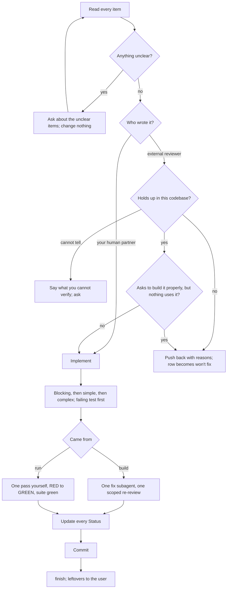

# Acting on review feedback

Treat each review finding as a claim to check against the code, then fix what holds up, push back on what does not, and record the outcome of every row.

## When to use
- Findings arrived in `review.md`, usually straight after `ai-native-sdlc:review` at the end of `ai-native-sdlc:build` or `ai-native-sdlc:run`.
- Someone left comments on a pull request.
- Your human partner handed you notes on the code.

Start here before changing a single line, and most of all when a point looks vague or technically doubtful. Feedback is input to evaluate. It is not a performance to applaud, and it is not an order to carry out unexamined. Check before you build, ask before you guess, and let technical correctness win over keeping everyone comfortable.

## Steps



### 1. Take it all in, then make sure you understand it
Read the whole list before reacting to any part of it. For each item, say the requirement back in your own words; if you cannot, it goes on the question list.

If even one item is unclear, stop there. Implement nothing, including the items you do understand, and ask about the unclear ones first. Items in one review often depend on each other, and a fix built on half an understanding tends to be the wrong fix.

> Partner: "Please handle findings 2 through 7."
> You follow 2, 3, 6 and 7, but not 4 or 5.
> Wrong: fix 2, 3, 6, 7 now and raise 4 and 5 afterwards.
> Right: "2, 3, 6 and 7 are clear. Before I start on any of them: what does 4 want changed, and does 5 apply to the CLI too?"

### 2. Check each item against the code
Weigh the item by who wrote it.

**Your human partner.** Trusted: once you understand a point, implement it. Still ask when its scope is unclear. Go straight to the work or to a short technical acknowledgment, without agreeable filler.

**An external reviewer** (the review subagent, a PR commenter, a bot). Be skeptical, but do the checking carefully. Before touching code, answer:
1. Is the suggestion technically right for this codebase and this stack?
2. Would it break something that works today?
3. Is there a reason the code is the way it is?
4. Does it hold on every platform and version the project supports?
5. Did the reviewer have the full context, or only the diff?

Then:
- The suggestion is wrong: push back with technical reasoning.
- You cannot verify it with what you have: say exactly that and ask. "I can't confirm this without the production config. Shall I dig into it, ask ops, or go ahead?"
- It conflicts with an earlier decision of your human partner: stop and talk to your partner before doing anything.

**YAGNI check.** When a reviewer asks you to build something "properly" (a fuller feature, a sturdier abstraction), first grep the codebase for real callers.
- Nothing calls it: propose deleting it instead. "Nothing references `exportAuditLog`. Remove it rather than extend it?"
- Something calls it: build it properly.

Your human partner's view: you and the reviewer both answer to them, and a feature nobody needs should not be added.

### 3. Decide what to push back on
Push back when the suggestion:
- breaks behavior that works today;
- comes from a reviewer missing context;
- adds something unused (YAGNI);
- is technically wrong for this stack;
- ignores a legacy or compatibility constraint;
- runs against an architectural decision your human partner made.

A finding you push back on and do not fix gets Status `won't fix: <reason>` in step 5.

### 4. Implement, one item at a time
Order of work:
1. Anything still unclear is settled first (step 1).
2. Blocking items: breakage, security.
3. Simple items: a typo, a missing import.
4. Complex items: refactors, logic changes.

Each fix starts with a test that fails for the reported reason (`ai-native-sdlc:tdd`), then the change that makes it pass. Test every fix on its own; once all are in, run the whole suite to confirm nothing regressed. Leave Nits alone unless the user asks for them.

How many passes, and who makes them, depends on where the work came from:
- **From `ai-native-sdlc:build`:** ONE fix subagent receives the complete list of findings. After it, ONE re-review restricted to the fix scope, dispatched from `../build/re-review-prompt.md` with a package built by `../build/scripts/review-package` for the fix range.
- **From `ai-native-sdlc:run`:** you make one fix pass yourself, RED then GREEN for each item, ending with a green suite.

Either way there is no second fix pass. What is still open afterwards goes to the user to decide at `ai-native-sdlc:finish`.

### 5. Update review.md and commit
Give every row a final Status: `fixed <sha>`, `won't fix: <reason>`, or `needs decision`. Then commit the code, the tests and review.md as `sdlc(<slug>): review findings addressed`.

### 6. Answer on GitHub where the comment lives
For an inline review comment on a pull request, reply inside its thread:

```bash
gh api repos/{owner}/{repo}/pulls/{pr}/comments/{id}/replies -f body='Fixed in a41c0d2: the timeout now comes from config.'
```

Never answer an inline comment with a top-level PR comment.

## Rules

### How you answer
- Do not perform agreement. "You're absolutely right" breaks an explicit rule of the instruction file; "Great point" and "Excellent feedback" are performance that says nothing about the code.
- Do not thank the reviewer. Not "Thanks for catching that", not "Thanks" for anything, no gratitude in any wording. The fix itself shows you listened. If you notice a "Thanks" in your draft, delete it and write the fix in its place.
- Do not announce "I'll implement that now" for an item you have not verified yet.
- Instead: restate the technical requirement, ask a precise question, push back with reasons, or simply start the work.
- When a finding is right, say what changed:
  - "Fixed: `parseDate` now rejects month 13 (dates.ts:41)."
  - "Good catch: the cache key ignored the locale. Fixed in cache.ts:88."
  - Or say nothing and let the diff speak.

### How you push back
- Argue from code, tests and facts, not from defensiveness.
- Ask specific questions rather than general doubts.
- Point at a test or a code path that shows the current behavior works.
- Bring your human partner in when the disagreement is architectural.
- If saying no out loud feels awkward, name that awkwardness and tell your partner what you found anyway; a candid "I think this one is wrong" helps them more than silence.

Example of verifying before agreeing:

> Reviewer: "Drop the polyfill for `structuredClone`."
> Wrong: "Great point! Removing it."
> Right: "Checked: `engines` still allows Node 16, and `structuredClone` landed in 17. The polyfill stays unless we raise the floor. Raise it to 18, or keep the polyfill?"

### When you were the one who was wrong
State the correction as a fact and carry on: "I re-ran it against the fixture and the reviewer is correct, the loop skips the last row. Fixing." No long apology, no defense of why you objected, no extra explanation.

### Traps, by phase
- Reading: acting on half the list while other items are unclear leaves a partial, often wrong result. Clarify everything first.
- Checking: assuming the reviewer must be right leads to breakage. Check what the change would break. Blind implementation skips the codebase check entirely.
- Unverifiable items: going ahead anyway hides a risk. Name the limit and ask which way to go.
- Deciding: dodging pushback to keep things smooth trades correctness for comfort. Correctness wins.
- Fixing: batching several fixes and testing once at the end hides which one broke what. One item, one test.

## Output and handoff
- Code and tests for the accepted findings, each fix proven by a test that failed first.
- review.md with a final Status on every row.
- One commit `sdlc(<slug>): review findings addressed`.

Next is `ai-native-sdlc:finish`, where any `open` or `needs decision` row is put to the user.
