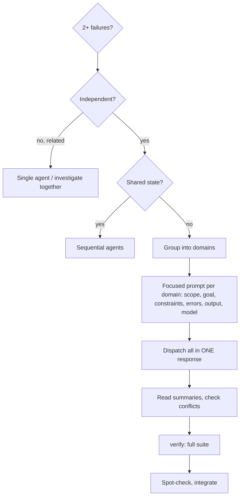

# Parallel

Split a set of unrelated problems into separate domains and send one subagent per domain, all at the same time. Each one gets a brief you wrote for it, and you keep your own context for coordinating the results.

## When to use

- You face two or more problems that look independent. Typical cases: three or more test files failing for different reasons, or separate subsystems broken in separate ways.
- Use it first, before you start debugging the problems one at a time.
- Each problem can be understood without knowing about the others, and the investigations would not touch shared state.

Do not use it when:

- the failures may share a cause, so fixing one could fix the rest;
- you do not yet know what is broken, and the work is exploratory debugging;
- understanding the problem needs a view of the whole system;
- the agents would collide, by editing the same files or using the same resources.

Do not use it to run two implementers on the same plan. Plans run through `ai-native-sdlc:build`.

Inputs: the list of failures (test files, test names, error messages) and the codebase.

## Steps



### 1. Decide

| Situation | Route |
|---|---|
| The failures are related, and one fix might clear several | Investigate them together: one agent, or you |
| Independent, and no shared state | Parallel dispatch (continue below) |
| Independent, but they share state, files or resources | Agents one after another, not side by side |

### 2. Cut the work into domains

Group the failures by what is broken: one domain per test file or per subsystem. For example, after a large rename lands:

- `invoice-totals.test.mjs`: rounding in tax lines
- `email-digest.test.mjs`: the scheduler skips the Monday digest
- `export-csv.test.mjs`: the header row is missing a column

Fixing tax rounding cannot change what the digest scheduler does, so these are three domains.

### 3. Write one brief per domain

Subagents start with none of your context and never see your history; give each one exactly what it needs. Each brief must contain:

- **Scope:** one file or one subsystem, named.
- **Goal:** for example, "make these tests pass".
- **Constraints:** for example, "change nothing outside `src/billing/`" or "only touch the tests".
- **Evidence:** the failing test names and their error messages, pasted in, not described.
- **The real cause:** tell the agent to find the actual root cause. Raising a timeout, or loosening an assertion until it passes, is not a fix.
- **What to return:** a short summary of the root cause and of every change made.
- **Model:** name it in each dispatch; do not leave it to the default.

Example brief:

```markdown
Two tests fail in tests/email-digest.test.mjs:

- "sends the weekly digest on Monday 08:00 local" - no email queued
- "skips users who unsubscribed" - expected 0 sends, got 2

Scope: src/digest/ and that test file only. Do not edit other modules.
1. Read both tests and work out what each one checks.
2. Find the root cause. Is the scheduler wrong, the time-zone handling, or did the test assumption change?
3. Fix the cause. Do not add sleeps and do not widen time windows to make the tests pass.

Return: the root cause in two or three sentences, and each file you changed with a one-line reason.
```

Before you send a brief, check it against the list above. Every field must be filled in:

- The return field is empty: you will have to dig through the diff yourself to learn what happened.
- No limits are set: one fix can spread into other agents' domains and collide with them.
- The scope is the whole suite: the agent is effectively debugging everything, which is the job parallel was supposed to split up.
- The evidence is a guess ("some race condition") with no file named or error pasted: the agent spends its budget searching instead of fixing.

### 4. Dispatch them all in one response

Send every dispatch in the same response, using your agent's subagent mechanism. Several dispatches in one response run in parallel; one dispatch per response runs them in sequence, which defeats the purpose.

```text
Subagent (model: <named>): invoice-totals.test.mjs - tax rounding
Subagent (model: <named>): email-digest.test.mjs - Monday digest
Subagent (model: <named>): export-csv.test.mjs - missing header column
```

### 5. When they come back

1. Read every summary so you know what changed and why.
2. Check for conflicts: did two agents edit the same code?
3. Run the full suite through `ai-native-sdlc:verify`, so you know the fixes work together.
4. Spot-check the work. Agents can repeat the same mistake across domains.
5. Integrate the changes.

## Rules

- Make the independence decision before you dispatch anything (and recall the exploratory-debugging exclusion under When to use).
- One domain per agent. Never give two agents the same files.
- Write each brief so that it stands alone, with the errors pasted in; never rely on context the agent does not have.
- Every brief demands the root cause and names a model.
- Dispatch all agents in a single response.
- Do not claim the batch is fixed until the full suite has passed under `ai-native-sdlc:verify`.
- Inside each agent the usual debugging method still applies.

## Output and handoff

The result is fixes spread across the affected files, plus one summary per agent. This skill writes no progress.md field and no commit message of its own. Next, run `ai-native-sdlc:verify` on the full suite after integrating. Each agent works under the `debug` method within its own domain.
