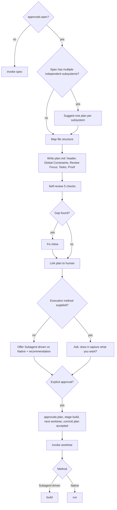

# Plan

Turn an accepted spec into plan.md: a list of small, testable tasks that records every decision the implementer could not make alone.

## When to use

- The change's progress.md carries `approvals.spec`, the work has more than one step, and no code has been written yet. Without an accepted spec, go to `ai-native-sdlc:spec` first.
- Say this before anything else: "I'm using the plan skill to create the implementation plan."
- Do not create a worktree here. Isolation comes after approval, when this skill hands off to `ai-native-sdlc:worktree`.

## Steps



### 0. Know the reader and the target

Read spec.md (bounded change: the Design section of progress.md), progress.md, and enough of the codebase to name real files.

Write for a capable newcomer to this repo and this spec.

| Leave to the implementer | Write into the plan |
|---|---|
| Idiomatic code in the project's language | Every file touched, and its job |
| Function bodies, once signature and test are fixed | Names, signatures, types |
| Reasonable calls where you left a choice open | Numbers, strings and formats the spec pins |
| | The tests that prove each task |

House style for the tasks: bite-sized, no repetition, nothing the spec did not ask for, a test ahead of each piece of code, a commit at the end of each cycle.

| Change kind | The plan lives in |
|---|---|
| Normal change | `sdlc/changes/<slug>/plan.md` |
| Bounded change (no spec.md, no plan.md; its design sits in `## Design`) | a `## Plan` section of progress.md, placed above `## Log`, written in the same task form |
| Your human partner named another place | their choice wins over both rows above |

### 1. Check the scope

Splitting a spec into sub-projects is normally done during spec. When a spec still spans several subsystems that could ship separately (say, a billing export and an unrelated admin dashboard), propose one plan per subsystem. Every one of those plans must end in software that runs and can be tested by itself.

### 2. Map the files

Settle the file list before writing a single task; task boundaries follow from it. For each file the change needs, answer these questions:

| Question | Answer that holds up |
|---|---|
| What is this file's one job? | One sentence with no "and". Two jobs means two files with a narrow interface between them. |
| Will it fit in one reading? | Yes. A short file gets edited correctly; a sprawling one gets edited by guesswork. |
| What else changes when it changes? | Those files sit beside it. Organize by feature (route, its validation, its test together), not by layer (all routes here, all validators there). |
| How does the repo already do this? | Follow that. If the repo favors large files, so does the plan. Only a touched file that has grown unmanageable may be split, and the split is a planned step. |

The answers become `## Files that change`. Check that every task built on this map leaves a change that stands on its own.

### 3. Cut the tasks

A task is the smallest piece that has its own test cycle and justifies a fresh reviewer's gate.

- Setup, configuration, scaffolding and docs are not tasks of their own. Put each inside the task whose deliverable needs it.
- Draw a boundary only where a reviewer could sensibly reject one task and approve the next.
- End every task on a deliverable that can be tested independently.

Inside a task, each step is a single action whose result can be checked. A typical sequence is five steps: add a test that fails; run it and watch the failure; write just enough code to pass; run it and watch it pass; commit.

### 4. Write the plan

Start plan.md with the header below. The blockquote is a fixed line: it is what tells whoever picks up the plan which skill executes it and how progress is tracked, so paste it unchanged.

```markdown
# Plan: [Feature Name] (from spec.md YYYY-MM-DD)

> **For agentic workers:** REQUIRED SUB-SKILL: Use ai-native-sdlc:build (recommended) or ai-native-sdlc:run to implement this plan task-by-task. Steps use checkbox (`- [ ]`) syntax for tracking. Tick each step's checkbox in this file as it completes; log each session in progress.md.

**Goal:** [the one-sentence outcome]

**Architecture:** [two or three sentences on the approach]

**Tech Stack:** [main languages, frameworks, libraries]

**Spec:** `sdlc/changes/<slug>/spec.md`

## Global Constraints

## Review Focus

## Files that change

## Order of work

## Risks

## Proof

---
```

Fill the sections working backwards from proof:

1. **Proof.** One line per R# in the spec, naming the test or command that demonstrates it. A requirement you cannot prove here is a requirement no task covers yet.
2. **Files that change.** The table from step 2.
3. **Order of work.** The `### Task N` sections (step 5).
4. **Risks.** What could go wrong, and what in the plan limits the damage.
5. **Global Constraints.** Scan the spec once for rules that bind every task rather than one feature, for example `Node >= 20`, "no new runtime packages", "all user-facing text in Vietnamese", "must run on Windows". Paste each one exactly as the spec words it, one per line. Every task's requirements include this list without restating it.
6. **Review Focus.** Five lines produced by self-review check 4, each phrased as "condition → behavior a sensible user expects", likeliest first.

### 5. Shape every task

Use exactly the heading form `### Task N: <name>`. `../build/scripts/task-brief` copies a task out of the plan starting at that heading and stopping at the next task heading or the next `#`/`##` heading; lines inside code fences never count as headings. Any other heading form breaks the brief.

The skeleton is `### Task N: [Component Name]` followed by Files, Interfaces and the steps. A filled-in task:

````markdown
### Task 3: Duration parser

**Files:**
- Create: `src/time/parse-duration.mjs`
- Modify: `src/cli/options.mjs:40-58`
- Test: `tests/parse-duration.test.mjs`

**Interfaces:**
- Consumes: `normalizeUnit(raw: string) -> 'ms' | 's' | 'm'` from Task 2
- Produces: `parseDuration(text: string) -> number` (milliseconds; throws `RangeError` on empty input)

- [ ] **Step 1: Write the failing test**

```js
test('parseDuration reads minutes and seconds', () => {
  assert.equal(parseDuration('2m30s'), 150000);
  assert.throws(() => parseDuration(''), RangeError);
});
```

- [ ] **Step 2: Run the test and see it fail**

Run: `node --test tests/parse-duration.test.mjs`
Expected: FAIL, `parseDuration is not defined`

- [ ] **Step 3: Implement `parseDuration(text: string) -> number` in `src/time/parse-duration.mjs`**

Use a single regex over the unit suffixes.

- [ ] **Step 4: Run the test and see it pass**

Run: `node --test tests/parse-duration.test.mjs`
Expected: PASS

- [ ] **Step 5: Commit**

Run: `git add src/time/parse-duration.mjs tests/parse-duration.test.mjs && git commit -m "feat: parse duration strings"`
Expected: one commit with the two files
````

Each implementer receives only their own task's brief. The Produces line is therefore the one place a later task learns the exact names and types this task exports, and Consumes is where it states what it takes from earlier tasks. Write both as full signatures.

Every task has **Files** (Create / Modify with a line range / Test), **Interfaces** (Consumes and Produces), and `- [ ] **Step k: …**` checkboxes. A step that runs something has a `Run:` line and an `Expected:` line.

How to write each kind of step:

- **Running something:** give the command and the exact output that means success.
- **Pointing at another task:** name the task and the entry in its Interfaces block. Do not paste that task's code.
- **A test:** write the test out as code, with its name and every assertion, using the spec's literal values.
- **Code:** name the function, its parameters and return type, and the file it goes in, plus any value the spec fixes. Leave the body out. Include one only when the signature and tests still allow several algorithms, or when the spec dictates the exact text. Where a real choice remains, one line naming the approach is enough (as in Step 3 above).

The test for any step: a competent implementer reading it could write only one sensible thing.

### 6. Review the plan yourself

When the whole plan is written, reread the spec as if for the first time and run these five checks. Run them yourself; do not dispatch a subagent for this.

1. **Coverage.** Walk the spec requirement by requirement and name the task that delivers each one. If a requirement has no task, add the task.
2. **Step scan.** Read each step as its implementer would and ask two things. Could two competent people build different things from it? Then make the decision and write it down. Does it spell out code the signature and test already force? Then cut that code.
3. **Consistency.** Names, signatures, types and fields used by later tasks must match where earlier tasks defined them. Task 2 producing `loadConfig()` while Task 6 calls `readConfig()` is a defect.
4. **Review Focus.** Brainstorm what the software will actually meet once it runs: empty input, a huge file, a malformed date, two requests at once, a missing permission. For each, look for a test in some task. Take the untested ones, rank them by how likely they are to hurt a user, and write the top five into Review Focus. Then add a pinning test for each to the task that owns that code, in that task's usual step form. A spec that says nothing about an input does not make failing on it acceptable. If the section ends up empty, that must be because every case already had a test.
5. **Proportion.** Measure the plan against the spec. If the plan is several times the spec's length, or code fences take up most of the page, shrink every body to its signature, test names and assertions. Then repeat check 2 on the steps you shortened.

Fix what you find directly in the file and move on; the checks are not rerun.

### 7. Hand off for approval

Link the plan to your human partner and ask them to read it.

- **They already told you how to execute it.** Ask only whether the plan captures what they want, wait for their answer, then keep the method they chose. Example: "The plan is in `sdlc/changes/<slug>/plan.md`. Does it say what you want built?"
- **They have not.** Ask for their review and lay out the trade-off:

| | **Subagent-driven** | **Native** |
|---|---|---|
| Who writes each task | a fresh implementer subagent per task | you, inline, in this session |
| Who checks, and when | a fresh reviewer after every task, plus a whole-branch review at the end | a single new reviewer running the strongest available model, once, over the whole branch |
| Cost | highest: a new context for every task and every review | lowest and quickest; a mid-tier session model is enough, since the plan carries the design |
| What you give up | nothing on rigor; this is the most thorough | no independent eyes until the branch is complete |

Close with your pick and one sentence of reason taken from this plan: how tightly the tasks lean on each other's interfaces, how many tasks there are, or what a mistake would cost once shipped. Example: "Eleven tasks share one data model and a bad migration would corrupt user records, so I recommend Subagent-driven. Does the plan say what you want, and which method should we use?"

### 8. Record approval and move on

Only after your partner explicitly approves:

1. In progress.md set `approvals.plan`, `stage: build`, and `next: ai-native-sdlc:worktree → build`.
2. Commit as `sdlc(<slug>): plan accepted`.
3. Invoke `ai-native-sdlc:worktree`.
4. Continue with the method your partner chose:
   - Subagent-driven: **REQUIRED SUB-SKILL:** Use ai-native-sdlc:build
   - Native: **REQUIRED SUB-SKILL:** Use ai-native-sdlc:run

## Rules

- No accepted spec, no plan. Send the change back to `ai-native-sdlc:spec`.
- Do not touch code while planning; the plan describes the code, it does not write it.
- Never change a task heading away from `### Task N: <name>`, and never drop the checkbox form `- [ ] **Step k: …**`. The build scripts depend on both.
- Copy spec values exactly. A rounded timeout or a reworded error message is a new requirement nobody approved.
- Do not let the plan grow longer than the code it describes. If it has, you wrote the program; go back to signatures and tests.
- Do not write lines that postpone a decision: "TBD", "handle errors appropriately", "add checks where needed", "tests for all of this", a helper no task produces. Decide, or ask your partner.
- Do not hand the self-review to a subagent. It is your own checklist.
- Do not treat silence as approval. Wait for an explicit yes before touching progress.md.
- This skill dispatches no subagents and calls no scripts.

## Output and handoff

- `sdlc/changes/<slug>/plan.md`, or the `## Plan` section of progress.md for a bounded change.
- progress.md: `approvals.plan`, `stage: build`, `next: ai-native-sdlc:worktree → build`.
- Commit `sdlc(<slug>): plan accepted`.
- Next: `ai-native-sdlc:worktree`, then `ai-native-sdlc:build` (Subagent-driven) or `ai-native-sdlc:run` (Native). With no accepted spec, the next skill is `ai-native-sdlc:spec`.
