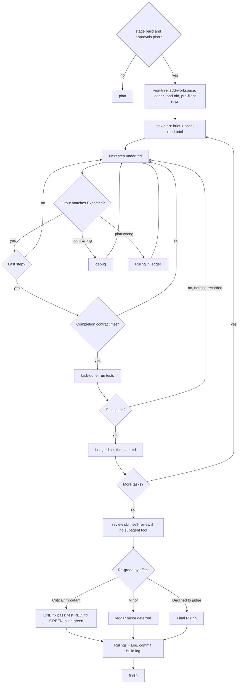

# Running a plan inline

You implement every task of the plan with your own hands, one after another, and pay for exactly one outside reviewer, who reads the finished branch cold.

## When to use

Pick this skill when every line below is true:

- The change has an accepted plan.md written by `ai-native-sdlc:plan`, and progress.md carries `stage: build` together with `approvals.plan`. If either is missing, go back to `ai-native-sdlc:plan`.
- Your human partner chose inline (Native) execution at the plan handoff, **or** your agent offers no subagent mechanism. In the second case, run the plan here; do not pretend you dispatched anything.
- The tasks are mostly independent of each other, the same bar `ai-native-sdlc:build` sets.

Route elsewhere in these cases:

| Situation | Use instead |
|---|---|
| Someone asks directly for one function or one bug fix, no plan involved | `ai-native-sdlc:tdd` |
| Your partner wants a reviewer to gate each task | `ai-native-sdlc:build` |
| The plan is so long that by its final tasks your context will have been compacted | `ai-native-sdlc:build` (inline can still finish it because the ledger allows recovery, yet the closing tasks get you at your weakest) |

Inline execution drops two things subagent execution provides on every task. Each has a stand-in here:

| Subagent execution gives each task | Inline replaces it with |
|---|---|
| An implementer that starts with a clean context | The task brief, which holds the exact values, plus the ledger, which holds your memory across compactions |
| A second reader who checks the result | TDD as the gate every task must clear, and one reviewer who reads the whole branch at the end |
| Price: two cold starts per task, each re-reading the codebase | Price: one context (yours) and one reviewer |

Where model capability is worth paying for:

| Role | Model | Why |
|---|---|---|
| You, the inline executor | mid-tier is enough | a fully specified plan reduces the work to transcription plus tests |
| The final reviewer | the most capable one | the only fresh judgment in the run; this skill dispatches it on its own |

Mention this split to your partner at the moment they pick inline.

## Steps

Treat the plan's design decisions as settled. Three duties remain for you, in this order: fidelity (build what the plan says, nothing extra), proof (every step shown red and then green in this session), and record (ledger lines your compacted future self can rely on).



### Standing orders for the whole run

| When | Your move |
|---|---|
| A task has just closed and others remain | Open the next one at once. Your partner picked inline to save their attention, and a progress question costs exactly that. |
| You are between two tool calls | Write one short line, or nothing. The ledger and the tool results already tell the story. |
| The plan is vague, self-contradictory or wrong | Settle it. The spec outranks the plan, the plan outranks your preference, and your judgment covers what neither addresses. Append `Ruling: <what you decided> — <why> — <what it costs if wrong>` and move on. Never depart from the plan without that line. |
| An operation is destructive or cannot be undone; an action is security-sensitive; a side effect would leave this worktree in a way convention says to ask about (merging, pushing to a branch others use, publishing); or the plan is so broken that any route forward is a guess | Stop and ask your partner. This list of four is complete: nothing else is a reason to halt. |
| A command will produce a lot of output | Redirect it into a file in the workspace and read the tail. All printed text and tool results remain in context until the session ends; for the same reason, open the brief, not the plan. |
| A ledger line is due | Put the append in the call that does real work (the commit, the edit). Every extra call re-reads the full context. |

### 1. Set up

1. Get an isolated workspace with `ai-native-sdlc:worktree`, which creates one or confirms the one you are in. Do not begin implementation on main or master unless your partner has explicitly said yes.
2. Check the gate: progress.md must show `stage: build` and `approvals.plan`. Missing either one means you hand over to `ai-native-sdlc:plan` and stop here.
3. Settle PLAN_FILE. For an architectural change it is `sdlc/changes/<slug>/plan.md`. A bounded change has no spec.md or plan.md; its PLAN_FILE is `sdlc/changes/<slug>/progress.md`, its `## Design` section is the spec and its `## Plan` section is the plan.
4. Locate the workspace: from this skill's folder, run
   `bash ../build/scripts/sdd-workspace PLAN_FILE`
   It prints `<repo-root>/.ai-sdlc/sdd/<slug>/`, a git-ignored folder holding everything for this one plan: ledger, briefs, review packages. You share it with `ai-native-sdlc:build` (same folder, same ledger format), so a plan can switch executor halfway and the newcomer resumes from the same ledger. A folder belonging to any other plan is off limits: do not read it, do not write it.
5. Open `<workspace>/ledger.md` and act on what you find:
   - **No ledger yet.** Create it. Its first line is its identity: `# SDD ledger — plan: <plan file path>`.
   - **First line names your PLAN_FILE.** Every task that has a `Task <N>: complete` line is finished. Do not redo it; begin at the lowest-numbered task without one. Those commits are in git even if you have no memory of making them. After a compaction, trust the ledger and `git log` over your recollection.
   - **First line names a different plan file.** That is someone else's progress. Leave it untouched and start a fresh ledger of your own.

   Sources for "where am I?", most trustworthy first: the ledger, then `git log`, then your harness todos (a live view that compaction wipes), then your memory. Re-implementing a task whose commits are already in history is the most expensive slip an inline run can make, so keep the ledger, not just todos. The workspace is git-ignored scratch, which means `git clean -fdx` erases it; should that happen, `git log` is what you rebuild from.
6. Read the inputs once, and only once: plan.md, spec.md, intent.md and progress.md. Note the plan's context and its Global Constraints. If the plan names a spec, read it: it is the authority that settles conflicts inside the plan. When no spec can be reached, put a note in the ledger saying so, because any ruling made without one is provisional. Create one todo per task.
7. **REQUIRED SUB-SKILL:** load ai-native-sdlc:tdd before you touch Task 1; its discipline applies to all steps in all tasks. Even when the plan itself spells out "failing test first", load the skill anyway.

### 2. Pre-flight scan

Before Task 1, look for clashes between tasks, guided by each task's Interfaces block.

| Situation | What goes in the ledger |
|---|---|
| Task B consumes something Task A produces | One row: both task numbers, what A produces set against what B consumes, and your finding |
| A task shares nothing with any other | No row |
| No task in the plan shares anything | The single line `Pre-flight: no shared interfaces` |
| A row exposes a conflict | Your ruling, written beside that row, with the spec as the binding authority |

Then start Task 1. The internal consistency of each task is checked later, when you read its brief.

### 3. Run each task

**a. Take it.** Run
`bash scripts/task-start PLAN_FILE N`
One call prints two lines: `brief:` with the path of the task's brief, and `base:` with BASE, the commit this task's review range is cut from. Read the brief on every task, including the ones you think you remember from setup. Your memory holds a summary; the brief holds the exact values, signatures and test cases. Set the task's todo to in_progress.

**b. Work the steps in order.** The plan already lists them in red-green order; follow that order under `ai-native-sdlc:tdd`. Write a test step's code first and run it first. Seeing it fail counts as a step of its own. If a test passes before the implementation exists, that is a finding about the test.

**c. Compare every command.** Command steps come with an `Expected:` line. Execute the command, read what it really printed, and hold the two side by side.

- *It matches:* go to the next step.
- *The code is wrong:* switch to `ai-native-sdlc:debug` and find the cause. Do not bend the code until the output looks like `Expected:`.
- *The plan is wrong* (the step contradicts the spec, an earlier task's interface differs from what this one consumes, or the command cannot possibly work): pick the smallest change that still satisfies the spec, append `Task <N>: Ruling: <finding> — <what you decided and why>` to the ledger, and continue. Later tasks touching the same interface pick the ruling up from the ledger, not from your memory.

**d. Commit** wherever the plan's commit steps say. Several commits in one task are fine. The review range always starts at BASE; never derive it from `HEAD~1`.

**e. Check the completion contract.** **REQUIRED SUB-SKILL:** ai-native-sdlc:verify, which governs this claim. With evidence produced in this session, not inferred from a diff that looks right, all four must hold:

1. Each test the brief names exists, ran during this task, and you read its output.
2. The task's final test run passed. That run is `task-done`, which writes the command and its result into the ledger line.
3. Every `Expected:` line in the brief has been compared with real output.
4. Each place you departed from the brief is covered by a ledgered `Ruling:`.

Short of even one item? Then the task is still open: return to it and complete it.

**f. Close it.** Run
`bash scripts/task-done PLAN_FILE N BASE -- <test command>`
with the whole-task test command the brief names. The script runs it, saves the full output as `task-<N>-tests.log` in the workspace, prints the last five lines, and, only when the command exits 0, appends this line to the ledger (creating the ledger header first if the file is missing):

`Task <N>: complete (commits <base7>..<head7>, tests: <command> → <result>)`

Here `<result>` is the last non-blank line the tests printed.

A failing run exits with the test command's own code and records nothing; the task stays open, so return to the steps. Once the line is recorded, mark the todo complete and, in that same message, mark this task's step boxes `- [x]` in plan.md (a bounded change keeps them in the `## Plan` section of progress.md). Leave anything inside fenced code alone.

**g. Next.** If tasks remain, go back to (a).

### 4. Final review

Invoke `ai-native-sdlc:review`, asking for the most capable model and passing the plan's Review Focus plus every `Ruling:` line from the ledger. It writes review.md.

When your agent has no subagent mechanism, do the review yourself instead: read `../review/code-reviewer.md` and run that review on the package as its own pass, once the final task's ledger line is written. Write `Final review: self-review (no subagent tool)` into both the ledger and review.md. Say plainly in your final message that the author reviewing their own work is weaker than a fresh reviewer, and that your partner decides whether it is enough before merging.

### 5. Sort the findings

Grade each finding yourself before it goes anywhere; the reviewer's label is only a suggestion and the gate belongs to you.

- **The question:** if this shipped today, what would a reasonable user of the software run into?
- **Not the question:** does the spec mention the input that triggers it? A spec describes intent and leaves most edge cases unnamed, so its silence never lowers a grade. A Minor that rests on "the spec doesn't cover this" gets re-graded on the harm.

Then route by your grade:

| After re-grading | Destination |
|---|---|
| Critical or Important | The fix pass (step 6) |
| Minor | Ledger line `Final: minor (deferred): <one-liner>`, and the "Deferred minors" list of your final message. Never fix it, never turn it into a ruling: a ruling settles a conflict, it is not a record that you skipped a polish note. |
| A "Declined to judge" line | A ruling you make and ledger: `Final: Ruling: <behavior the reviewer set aside> — <what a reasonable person using this software gets, and why that stands or why it is now a finding> — <cost if wrong>` |

### 6. One fix pass

You are the implementer, so you fix the Critical and Important findings yourself, all in a single pass. TDD verifies each fix, not another reviewer:

1. Write a test that reproduces the finding.
2. Run it and watch it fail.
3. Fix the code until it passes.
4. Run the whole suite.
5. Ledger it: `Final: fixed <finding> — <test name> RED→GREEN, suite <N>/<N>`.

Conditions on the pass:

- Proof per fix is a test that was red before the change. No red run, no verified fix.
- The pass ends only on a green full suite.
- Do not dispatch a re-review. Each finding's own test already answers "was it addressed?", and the suite already answers "did anything else break?".
- To leave a finding as it is, ledger `Final: Ruling: <finding> — <why the code stands> — <cost if wrong>`; it reaches your partner with the other rulings.
- Fill review.md's Status column with each finding's outcome, as `ai-native-sdlc:fix-review` describes.
- Do not open a second fix pass.

### 7. Finish

1. Before anything is deleted, build two sections of your final message from the ledger:

   | Section | Source lines | How |
   |---|---|---|
   | "Rulings I made" | every line containing `Ruling:` | chronological, every entry carrying its cost if wrong |
   | "Deferred minors" | every `minor (deferred)` line | all of them |

   Omit nothing from either. No other channel carries to your partner the choices you made for them or the findings you left alone.
2. Under `## Log` in progress.md, append an entry headed `### <YYYY-MM-DD> — <person> + <agent>` (take the agent name from your session context) containing the same two lists, the commits, and whatever is left unfinished. Update `next`. Commit as `sdlc(<slug>): build log`.
3. Invoke `ai-native-sdlc:finish`. Once the change is done it deletes this plan's workspace; sibling folders under `.ai-sdlc/sdd/` belong to other plans.

## Rules

Before the first task:
- Do not start without `stage: build` and `approvals.plan`, and do not start on main or master without your partner's explicit consent.
- Do not dispatch an implementer subagent or a per-task reviewer. The only subagent this skill uses is the final reviewer, through `ai-native-sdlc:review`.
- Do not skip loading `ai-native-sdlc:tdd`.

During each task:
- Open the brief every time, even for a task you believe you remember. Recall keeps the gist and drops the exact values; the file keeps both.
- Run each new test before its implementation and see it fail. A test you have only ever seen green may be testing nothing.
- Run each step's verification when the step says, not in one batch at the end. Batching hides which step broke things; the `task-done` run is the contract on top of those runs, not a replacement for them.
- Do not depart from the plan without a `Ruling:` line in the ledger, however obvious the right answer looks. An unrecorded fix is a choice your partner can never review.
- Write the ledger line together with the commit, not later. Compaction does not wait for you to catch up.
- Do not claim a pass you have not seen. "It was a trivial change" is a forecast; the command and its printed result are the evidence.
- Do not patch a symptom so the output matches `Expected:`; find the cause with `ai-native-sdlc:debug`.
- Do not cut a review range from `HEAD~1`; use BASE.
- Do not write a completion line by hand; only a passing `task-done` run records one, and do not redo a task the ledger already marks complete.
- Do not touch another plan's ledger or workspace.

Between tasks:
- Do not ask whether to continue. Courtesy check-ins spend the attention your partner chose inline to save; only the four stops halt you.

At review and after:
- Never skip the final review: not because you read your diff closely (an author shares their own blind spots), and not to save money (inline already removed every per-task review, so this one is the minimum).
- Do not accept a severity label as given; re-grade by the harm to users.
- Do not fix anything without a test that failed first. Without it you cannot show the problem was real or that it is gone.
- Do not fix Minor findings, and do not record them as rulings. Each would cost a test, a change and a suite run nobody requested; ledger it and let your partner decide.
- Do not dispatch a re-review, and do not start a second fix pass.
- Do not leave a ruling or a deferred minor out of the final message.

## Output and handoff

Produced:

- In the workspace `.ai-sdlc/sdd/<slug>/`: `ledger.md` with `Pre-flight` rows, `Task <N>: complete …` lines, `Task <N>: Ruling …` lines and `Final: …` lines; `task-<N>-brief.md` files; `task-<N>-tests.log` files.
- Ticked step checkboxes in plan.md (or in the `## Plan` section of a bounded change's progress.md).
- review.md with each finding's Status filled in.
- A Log entry and an updated `next` in progress.md, committed as `sdlc(<slug>): build log`.
- A final message carrying "Rulings I made" and "Deferred minors".

Hands off to: `ai-native-sdlc:worktree` at setup, `ai-native-sdlc:tdd` as the sub-skill for every task, `ai-native-sdlc:debug` whenever the code is wrong, `ai-native-sdlc:verify` for each completion claim, then `ai-native-sdlc:review`, `ai-native-sdlc:fix-review`, and last `ai-native-sdlc:finish`.

A short session, for shape (a plan adding CSV export to a reports page):

```text
Setup: worktree confirmed; sdd-workspace → .ai-sdlc/sdd/2026-03-02-csv-export/, no ledger, created
Read plan + spec once; Pre-flight: 1 row (Task 1 produces toCsvRow, Task 3 consumes it), consistent
Loaded tdd; todos for 3 tasks

Task 1  task-start → brief read, base 9f31c0e
        csv-row test: red (toCsvRow undefined) — as Expected
        implement → green 3/3 — as Expected; commit 2ab84d1
        task-done … -- npm test -- csv → Task 1: complete (commits 9f31c0e..2ab84d1, tests: npm test -- csv → 3 passing)
        ticked Task 1 steps in plan.md

Task 3  brief asks for header "Amount (VND)"; spec R2 says "Amount"
        ledger: Task 3: Ruling: header text — follow spec R2 "Amount"; plan copied an old mock-up
        …
Review: 1 Important (quotes in names not escaped), 1 Minor (filename lacks date)
  Important → escapes-double-quotes test red → fix → green, suite 14/14; ledger Final: fixed …
  Minor → Final: minor (deferred): export filename lacks date

Rulings I made: Task 3 header text (cost if wrong: one string change)
Deferred minors: export filename lacks date
Log appended, committed sdlc(csv-export): build log → finish
```
