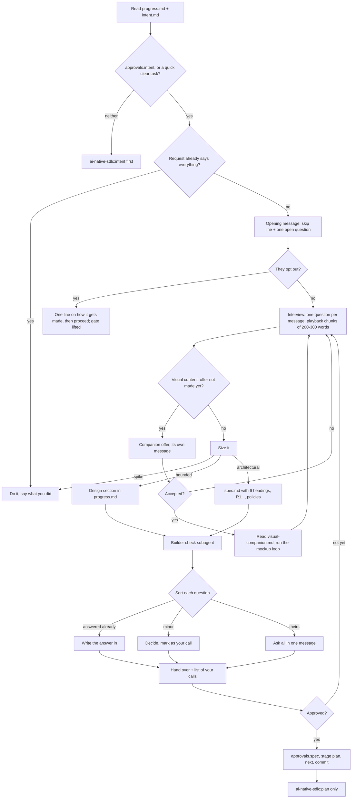

# Spec

Interview your human partner until you can state what they want and the reason behind it, write that down as the change's design, and keep everything un-built until they approve it.

## When to use
- A change folder has an accepted `intent.md` and the next artifact is its requirements and design.
- Someone asks for something to be made or changed (a feature, a component, new behavior, a plan for something new), with or without a change folder.
- Confidence is not a reason to skip it. The cheapest moment to discover you misread a request is before any of it exists; a wrong guess found in review costs a rebuild.

## Steps

### 1. See where the change stands
Open the change's `progress.md` and `intent.md`. When `approvals.intent` is missing and the request is not a quick, clear task, invoke `ai-native-sdlc:intent` before anything else. Otherwise take the intent's Open questions as your starting list of topics.

### 2. Decide whether a conversation is needed
Ask yourself one thing: what do I actually know about what they want, and why?
- The request already holds every decision that matters ("rename the Save button to Submit"): treat it as a quick, clear task. Make the change, report what you changed, and stop here; no change folder.
- Something that matters is missing: go to step 3.

### 3. Send the opening message
It has exactly two parts and nothing else:
1. A single line telling them they can skip the questions and have you start straight away.
2. A single open question that sets them talking about a concrete moment or picture, for example "What happened the day you decided this needed doing?" or "Picture it finished: what's the first thing you'd do with it?"

If they choose to skip: the skill ends here and the gate in step 10 goes with it. If you are making a significant choice about how it gets made (the platform, the language, the medium), state it in a single plain sentence, then carry out the request through the normal workflow.

### 4. Interview
**Message shape.** Each message closes on exactly one question, a single sentence, never followed by a list of possible answers. Put the important part first and keep it short. If you looked into something, report the two or three findings that matter and offer the remainder.

**What to learn.** Keep these areas in mind and fill them as the talk allows; do not recite them as questions:

| Area | What you want to come away with |
|------|---------------------------------|
| Their details | the specifics they care about |
| Today | what exists now and what they already tried |
| Prior art | things they have seen elsewhere and loved or hated |
| The thing itself | what kind of thing it is and what sets it apart |
| Timing and success | why it matters now; what "this worked" looks like to them |
| Boundaries | goals, non-goals, and anti-goals (ways it could technically work and still be a failure) |

**What to do when:**

| Situation | Move |
|-----------|------|
| You are about to ask anything | Make it open and tie it to something real: "What did you do the last time this came up, step by step?", "Which part would you protect if everything else got cut?", "What result would make you send it back?" |
| You think you know the reason but are not sure | State the guess so they can fix it ("Sounds like the shift handover is where orders get lost, is that it?"); a correctable guess often beats another question |
| They are stuck for words | Now, and only now, offer a short menu |
| They say "just guess" or "you pick" | Put one concrete proposal on the table |
| Medium, tools, materials or resources come up (platform, language and libraries for software; the medium for an artwork) | Raise this early. Ask which of these choices they want to make, which are yours to make, and what materials or tools are already on hand |
| They have strong views or skills there | Talk the choice through with them |
| They are counting on you there | Pick sensible defaults and say them in plain words |
| Something already exists | Build on what it already uses |
| You make any of these choices | Write it into the design as your decision, never as theirs |
| You have some grounding and looking would help | Offer recon of the code or project, files and data they own, or the web; name what you hope to find; go only on a yes |
| You are about to propose an approach | First, privately, sketch several, then cut the weak ones and every one that works against their stated reasons; show them a comparison only if it helps them choose |
| Building would settle a question faster than talking | Offer a spike (below) |
| The content is something to look at | Step 4a |

**Spikes.** Because you build fast, a disposable build is often the quickest way to find out what they want or whether an idea holds up; agentic work is still waterfall, just run very quickly. Offer one when that is true, and if they simply want a spike, do it without ceremony. What a spike skips: the change folder, the plan, implementation discipline and review; tests are absent or minimal, and nobody should expect it to be robust. What it owes you: whatever it taught you comes back into the conversation.

### 4a. The visual companion
The companion is a browser tab for mockups, diagrams and clickable prototypes. It is a tool you pick up per question; saying yes to it does not move the whole conversation there.

**When to offer.** Wait for the first moment the content is visual, then offer once, in a message that contains only the offer: "I could sketch this in a browser tab so you can see it instead of reading about it. Want me to?" Visual moments: alternatives that would look different; a map, timeline or diagram; a screen, page, printout or sign that someone will look at; the arrangement of a layout, a room or a week; a sequence of steps or a flow.

**After the offer.** On a no, continue in text and leave the subject alone unless they reopen it. On a yes, read `visual-companion.md` in this folder before starting the server, then use the tab for drafts they react to, options shown together, and throwaway prototypes they can click.

**Each question after that.** Route by what helps them understand: screens, arrangements and designs set next to each other go to the browser; scope, requirements, tradeoffs and abstract choices stay in text. A question that happens to be about a UI can still be a text question.

### 5. Play it back in chunks
Questions and playback take turns until the end of the conversation, and the last chunk sweeps up whatever is still undescribed. A chunk is due whenever one part has become clear, say its audience and purpose, or how a single piece behaves.

Before sending a chunk:
1. If it describes something they will look at (a printout, a page, a schedule, a screen) and the companion has not been offered, send the offer as its own message and keep the chunk for the following one. If they already accepted the companion, attach a mockup to the chunk.
2. Keep it to roughly 200-300 words about that one part.
3. Separate sources: what they told you is theirs, everything you inferred is flagged as your guess.
4. Finish with a question about what is wrong or missing.

Then resume asking, now about the next part.

### 6. Size the work
Once the request is understood, choose one of three sizes, name it in plain words, and let them overrule you.

| Size | Where the full description lives | What follows |
|------|----------------------------------|--------------|
| Quick, clear task (*spike*; no change folder) | in the request | you just do it |
| Small change (*bounded*) | a `## Design` section in progress.md, before `## Log` | `ai-native-sdlc:plan` writes `## Plan` in progress.md |
| Project needing a written design (*architectural*) | spec.md | `ai-native-sdlc:plan` writes the full plan |

If the work grows partway through, stop, tell them, and move up one size. If it turns out to be several independent projects, say so, agree on the order, and work through them one at a time.

### 7. Write the design
The test for the document: a talented builder in this domain could plan from it without ever going back to your human partner. Its content, and the heading each piece lands under when you write `sdlc/changes/<slug>/spec.md` from `<plugin root>/templates/spec.md` (keep all 6 headings) for an architectural change:

| Content | Heading |
|---------|---------|
| intent and the reason for it, goals, constraints | Requirements, numbered R1, R2, ... |
| the decisions they took about the how, recorded the way they took them, plus what is deliberately left to the builder | Design |
| non-goals and anti-goals | Out of scope |
| each Open question in intent.md, resolved or explicitly marked as carried over | Answers to open questions |

Write the content in Vietnamese. A bounded change gets the same material in its Design section.

### 8. Apply policies
List `.agents/skills/policy-*/SKILL.md`; until a repo has moved them, also look at the `policy-*` folders inside the `.claude` skills folder. Read each policy whose description fits this change. Under **Policies applied**, write the policy's name, its commit from `git log -1 --format=%h -- <path>`, and the constraint it places on the design. Anything that conflicts, carries high risk or rests on an unverified assumption goes under **Flagged concerns**, naming the policy owner.

### 9. Run the builder check
Start a fresh subagent with `builder-check-prompt.md` from this folder; if you have no subagent tool, play that builder yourself and read the document cold. Set expectations when you announce the write-up: a reviewer gets it first, and you might return once with a small batch of questions. The document stays with you until the check is back.

Sort every question the check raises:

| Pile | How to recognize it | What you do |
|------|---------------------|-------------|
| **Theirs:** | changes what gets built, and only your human partner knows the answer | collect for the single message below |
| **Minor:** | a sensible builder could settle it with no effect on what gets built | decide it and flag it in the document as your call |
| **Answered already** | the conversation or the project already settles it | write the answer into the document |

If the first pile is not empty, send all of it in one message, ordered by importance, and work the replies into the document. That is the only round of questions the check may cause. Hand the document over with a short list of the decisions you made on your own, so they know what to scrutinize while reading.

### 10. Hold the gate, then record approval

<HARD-GATE>
Blocked until your human partner approves the full written description (spec.md for architectural, the progress.md Design section for bounded):
- writing product code or scaffolding;
- installing dependencies or creating projects;
- invoking any implementation skill.

Always allowed: reading and exploring.

The gate does not apply after an opt-out at the opening message, because the skill ended there. It also does not apply to a spike they agreed to, as long as the spike stays labeled throwaway; keeping its output is a new request and goes through this gate like any other.

On approval: record `approvals.spec`, set `stage: plan` and `next: ai-native-sdlc:plan → plan.md`, commit `sdlc(<slug>): spec accepted`, and invoke `ai-native-sdlc:plan`. Invoke no other skill.
</HARD-GATE>

## Rules

**While talking**
- Use their vocabulary and plain words, a notch above their level. No process jargon.
- Never open with an explanation of how this skill works. It spends their attention before they have told you anything; the question is the explanation.
- Ask for a description before you show choices. Once three options are on screen, people pick the nearest one instead of telling you what they actually pictured.
- Say every default out loud. A default they never heard about resurfaces at review as a surprise, when changing it means rebuilding.

**While writing it up**
- Your own choices are labeled as your calls in the document, never presented as agreed.
- The builder check finishes before the handover, and it produces one round of questions, not a series.

**At the gate**
- Agreement during the conversation was agreement with a direction, not with details you had not written yet. Approval is given on the written description.
- Spike code skipped tests and review by design; continuing to build on it carries those gaps into the product. Keeping it is a new request.

## Output and handoff
- `sdlc/changes/<slug>/spec.md` (architectural) or the `## Design` section of `progress.md` (bounded); nothing for a quick, clear task.
- In `progress.md`: `approvals.spec`, `stage: plan`, `next: ai-native-sdlc:plan → plan.md`; commit `sdlc(<slug>): spec accepted`.
- If the companion was used, its scratch files sit under `.ai-sdlc/brainstorm/` and are git-ignored.
- Next: `ai-native-sdlc:plan`, and only that. Without an accepted intent, `ai-native-sdlc:intent` comes first.
