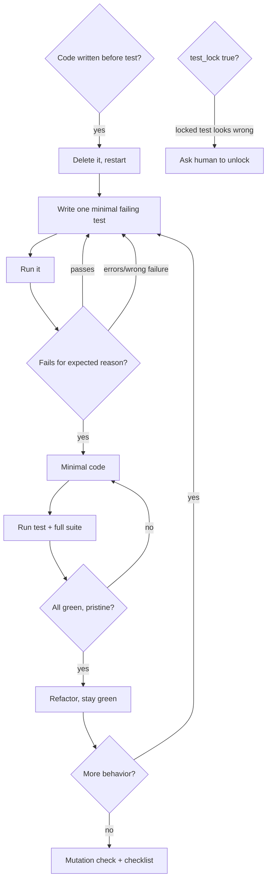

# Test-first development

Every piece of production code starts life as a test you have watched fail; this skill is the loop that gets you there and the rules that stop you from skipping it.

## When to use

- Any new feature, any function, any bug fix, any refactor, any change in behavior. Start before the first line of implementation, and that includes a lone function someone asks for outside a plan.
- Called from inside other work too: `build` implementers, the `run` executor (where it is required), Phase 4 of `debug`, and each fix made under `fix-review`.
- Only your human partner can grant an exception, and only for three kinds of work: a prototype that will be thrown away, generated code, configuration files. If you catch yourself deciding alone that this one case can skip the loop, that is the rationalization this skill exists to catch. Ask instead.

Inputs: `test_lock` in the change's progress.md; the project's test command, which in a harness repo is `verify.test` in `sdlc/config.json`; and [writing-good-tests.md](writing-good-tests.md), which you open every time you write or change a test.

## Steps



The law the whole loop serves:

```
NO PRODUCTION CODE WITHOUT A FAILING TEST FIRST
```

Obeying its wording while dodging its intent counts as breaking it.

### 0. Clear the ground

Look for implementation you already wrote for this behavior. If any exists, delete it before you write a test. Do not park it in another file, do not keep it open in a tab, do not glance at it while the test takes shape. You will build the behavior again, driven by the tests. If you explored first to learn the problem, that was fine; the exploration code goes in the bin too.

### 1. RED: one test, one behavior

- Pick the single next behavior. If the test name needs "and" to describe it, you have two tests.
- Before you write the body, say which production change would make it fail. It must be a bug (a wrong branch, a dropped side effect, a bad boundary), not a design decision. Then follow [writing-good-tests.md](writing-good-tests.md).
- The expected value is a literal you worked out by hand. Never let the code under test, or its helpers, compute it.
- Exercise real code. Reach for a mock only when nothing else works.
- Let the test show the API you wish you had; it is the first caller.

A test that earns its place:

```javascript
test('free shipping kicks in at exactly 50.00', () => {
  const cart = new Cart([{ sku: 'mug', price: 25.0, qty: 2 }]);
  assert.equal(shippingFor(cart), 0);
});
```

The behavior is in the name, the boundary is the point, the cart is real. Compare:

```javascript
test('shipping', () => {
  const rates = { lookup: mock.fn(() => 0) };
  shippingFor(fakeCart, rates);
  assert.equal(rates.lookup.mock.callCount(), 1);
});
```

Nobody can tell what this protects, and it only proves that a stub was called.

### 2. Watch it fail (never skipped)

Run just the new test, for example `node --test tests/shipping.test.mjs`. Read the result:

| What you see | What it means | What you do |
|---|---|---|
| It passes | The behavior already exists, or the test checks nothing | Fix the test until it fails |
| It errors (import error, typo, syntax) | It never reached the assertion | Repair the error and run again, until it fails properly |
| It fails, with the message you predicted, because the feature is missing | Genuine RED | Go to GREEN |

If you cannot say why it failed, you are not at RED yet.

### 3. GREEN: the least code that passes

Write the plainest code that turns this one test green. No options nobody asked for, no extra parameters, no tidying of nearby code. For the shipping test that means one comparison against 50, not a pluggable rate engine with currency support. Anything beyond the test is untested code, and YAGNI says you will not need it.

### 4. Watch it pass (never skipped)

1. Run the new test. If it fails, change the code. The test stays as it is.
2. Run the whole project suite: `verify.test` in a harness repo, otherwise the repo's normal command (`npm test`, `pytest`, `cargo test`, ...). Do this even when your task named a single test file. The task's scope limits what you deliver; it does not limit what you check.
3. If another test is red, fix it now, before going on.
4. The output must be clean: no stray errors, no warnings.
5. Name every failing test the suite shows in your report, including ones you did not break. A red line you saw and left out makes the report false.

### 5. REFACTOR, only once green

Now remove duplication, rename, pull out helpers. Run the tests after each move and keep them green. Add no behavior here; new behavior needs a new RED.

### 6. Next behavior

Go back to step 1 with the next failing test. When no behavior is left, run the mutation check from [writing-good-tests.md](writing-good-tests.md) and then the checklist in step 8.

### 7. Bugs go through the same loop

A bug is a missing test. Reproduce it with a failing test first, then fix it. Never fix a bug without one. Worked through:

- Bug report: `formatBytes(1536)` shows `1536 B`, but it should show `1.5 KB`.
- RED:
  ```javascript
  test('formats 1536 bytes as 1.5 KB', () => {
    assert.equal(formatBytes(1536), '1.5 KB');
  });
  ```
- Run it: `AssertionError: '1536 B' !== '1.5 KB'`. This is the predicted failure, so the RED is genuine.
- GREEN: add the `>= 1024` branch that divides by 1024 and keeps one decimal.
- Run the file, then the full suite: all pass, nothing extra printed.
- REFACTOR: if a unit table now makes sense for MB and GB, extract it, but only with the tests still green.

The test now guards the fix against the bug coming back.

### 8. Check before calling it done

- [ ] Each new function or method has at least one test.
- [ ] You saw every test fail before its code existed.
- [ ] Each one failed for the reason you expected: a missing feature, not a typo.
- [ ] The code is the minimum the tests demand.
- [ ] The full suite passes.
- [ ] The output is clean.
- [ ] Tests use real code; mocks appear only where unavoidable.
- [ ] Edge cases and error paths have tests.

If any box stays empty, you skipped TDD somewhere. Go back and do the loop properly.

### When you are stuck

- **You do not know how to test it.** Write the call you wish existed and the assertion you want, then ask your human partner.
- **The test is a tangle.** The interface is too complex. Simplify the interface, not the test.
- **You need to mock everything.** The code is too coupled. Pass dependencies in (dependency injection).
- **The setup is huge.** Extract helpers. If it is still heavy, simplify the design.

## Rules

### Locked tests

- When progress.md has `test_lock: true`, a hook refuses any change to a test file.
- Should a locked test seem wrong to you, stop and ask your human partner to set `test_lock: false`.
- Do not use Bash, or any other route, to edit a test the hook is guarding.

### Before the test exists

- Do not write production code first, not even a little. If you did, delete it and start over from a test.
- Do not keep pre-written code "for reference". You will end up copying from it, and that is writing tests after the code.
- Hours already spent do not change this. That time is gone whatever you do. The choice left is between code proven by tests and code you have to hope works.
- "It is too simple to need a test" is exactly how simple code ships broken. The test costs less than a minute.
- If you think the code is too hard to test, take that as information. Code that is hard to test is hard to use. Change the design.
- If the code you are changing has no tests, add tests for the parts you touch. Do not use the missing tests as permission.

### While RED

- A test that passes on its first run proves nothing yet. Make it fail first.
- Do not move to GREEN on an error or on a failure you cannot explain.

### While GREEN

- When a test fails, change the code. Do not weaken the test to match.
- Do not tell yourself TDD is slowing you down. Bugs caught before the commit are the fast path; debugging in production is the slow one.
- Do not plan to add the tests at the end. A suite written after the code only checks the cases you happened to think of while writing it, and every test in it passes the first time it runs, so none of them has ever been seen to catch a bug. A test written first records what the code should do; a test written later just records what the code already does.
- A manual check is not a test. Next week, after a refactor, nobody can replay what you clicked through, and a reviewer cannot see what you covered. Write the test that does the same check.

### Always

Stop and restart the loop as soon as you see any of the following signs. Delete the code and start over test-first.

- **Ordering signs.** Code exists before its test. A test is planned for "later". A test went green the moment it ran. A test failed and you cannot explain why.
- **Shortcut thoughts.** "Just this once." "This case is different." "I'm being pragmatic, not dogmatic."
- **Substitutes.** "I already tried it by hand." "Tests afterwards serve the same purpose, with less ritual."
- **Salvage.** "I'll adapt what I already have." "Deleting hours of work is wasteful."
- Whenever you write or change a test, follow the hygiene in [writing-good-tests.md](writing-good-tests.md): name the break; no change-detector tests; test behavior, not source text; test your own boundary, not the framework's; never assert on a mock; mock only at the slow or external level, after you know the real side effects; give doubles complete, realistic data structures; keep cleanup that only tests need in test utilities, not production classes; end with the mutation check.
- In short: if production code exists, a test for it existed first and failed first. Otherwise it is not TDD. Only your human partner can grant an exception.

## Output and handoff

You deliver tests plus the code they drove. When working as an implementer, put the TDD evidence in your report: the RED command and the failing output, then the GREEN command and the passing output. This skill changes nothing in progress.md, runs no scripts of its own (only the project's test command), and hands off to nobody. Control returns to whichever skill called it: `run`, a `build` implementer, `debug`, or `fix-review`.
