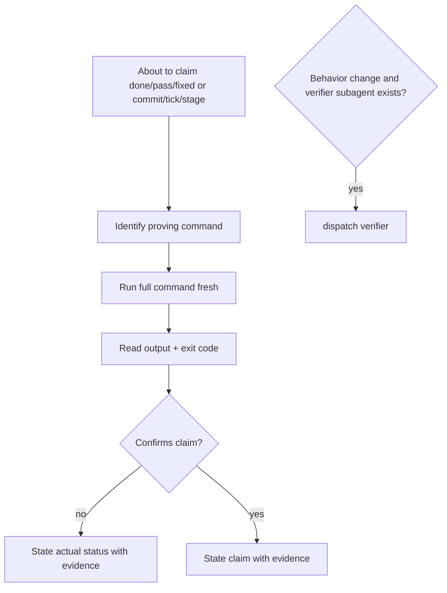

# Verify

A gate that runs before any claim that work is done: produce evidence from a fresh run, then state exactly what that evidence shows.

## When to use

Stop at this gate before you:

- say or imply that something is complete, fixed, passing or done, in any wording (a synonym, a paraphrase, "looks good", or a cheerful "Done!" all count)
- express satisfaction with the state of the work
- commit, push or open a pull request
- tick a checkbox in plan.md, or change `stage` in progress.md
- move on to the next task
- hand work to an agent, or accept the report an agent hands back

Other skills call it at their own checkpoints: `debug` once a fix is in, `run` as part of its completion contract, `finish` as its test gate, and `parallel` after integrating.

Inputs: in a harness repo, `sdlc/config.json` keys `verify.build`, `verify.test` and `verify.lint`; the R# list in spec.md; the Proof lines in plan.md; and the repo's verifier subagent definition if it has one.

## Steps



```
NO COMPLETION CLAIMS WITHOUT FRESH VERIFICATION EVIDENCE
```

Unless the command ran in this very message, you have nothing to claim from. Keeping to the wording of this rule while dodging its purpose still breaks it.

1. **Pick the proof.** Name the command, or the check, that would prove the exact claim you are about to make. In a harness repo, the commands are `verify.build`, `verify.test` and `verify.lint` from `sdlc/config.json`; run every key that is not empty. Each kind of claim needs its own evidence:
   - *Requirements met:* write a checklist with one line per R# in spec.md and one per Proof line in plan.md, and check each line. A green suite alone does not prove this.
   - *Bug fixed:* re-run the original symptom and see it behave. A code change alone proves nothing.
   - *Regression test works:* run the red-green cycle. Write the test and see it pass. Revert the fix and see the test **fail**. Restore the fix and see it pass again.
   - *Agent finished:* read the VCS diff yourself.
   - *Build ok:* the build command exits 0. A passing linter is not a build.
   - *Lint clean:* the linter reports 0 errors.
   - *Tests pass:* the test command reports 0 failures.
2. **Run it now, in full.** Run the complete command, not a subset and not a cached result from earlier.
3. **Read all of it.** Read the whole output, the exit code, and the number of failures. A summary line on its own is not enough.
4. **Compare.** If the output does not back the claim, report the real status and quote the evidence. If it does back the claim, make the claim and quote the evidence with it.
5. **Only now say it.** If you skipped any of the steps above, what you are reporting is a guess, not a verification.

A worked pass through the gate: an implementer subagent says task 4 is done.

- Run `git diff` and compare it with the brief. One of the two files it lists turns out to be untouched.
- Run `verify.build`, then `verify.test`. The build exits 0. The tests print `# fail 1`.
- Write out R3 and the task's Proof line and check them. R3 holds; the Proof line does not.
- Report exactly that: the build passes, one named test fails, one Proof line is unmet, and the task is not done. Quote the lines that show it.

### Behavior changes: the verifier subagent

If the change alters behavior and the repo defines a verifier subagent for your agent, dispatch it through your agent's subagent mechanism. It lives at one of these paths:

- `.claude/agents/verifier.md`
- `.codex/agents/verifier.toml`
- `.agents/agents/verifier.md`

If none of them exists, skip this step. The gate above still applies.

## Rules

- Run this gate before you tick any plan.md checkbox and before you move `stage`.
- Do not use "should", "probably", "seems to" or "looks like" to describe a result. Run the command and report what it printed.
- Do not celebrate ("Great!", "Perfect!", "Done!") before the evidence is on the screen.
- Do not reuse an earlier run. Code may have changed since; run it again.
- Do not take an agent's success report as fact. Read the diff yourself.
- Do not treat a partial check as proof of the whole. One file passing says nothing about the suite.
- Confidence, fatigue, time pressure and "just this once" grant no exemption.
- Rewording the claim does not get it past the gate. Any message that implies success counts as a claim.

## Output and handoff

This skill writes no file. Its output is the evidence quoted in your message (the command, the key lines of output, the exit code) next to the claim it supports, or the actual status when the evidence says otherwise. It gates other skills' writes: commits, plan ticks, `stage` moves and PRs wait until it has passed. It hands off to nobody; control returns to whatever was about to make the claim.
