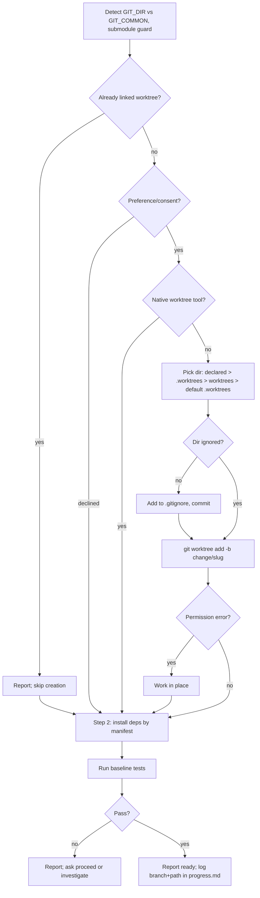

# Worktree

Make sure the change is built in an isolated workspace, reusing one that already exists, creating one only when needed, and proving the starting point is green.

## When to use

- Feature work is about to begin and should not disturb the current checkout.
- A plan has just been accepted: `ai-native-sdlc:plan` hands off here before `ai-native-sdlc:build` or `ai-native-sdlc:run`, and both of those call this skill during their own setup.
- Open with: "I'm using the worktree skill to set up an isolated workspace."

Inputs: the state of the git directory, any worktree preference or directory your human partner has declared in your instructions, an existing `.worktrees/` or `worktrees/` folder, and `verify.test` from `sdlc/config.json` in a harness repo.

Order of preference, always: reuse isolation that is already there, then the platform's own worktree tool, then plain git.

## Steps



### Step 0: Find out where you are

Compare the per-worktree git directory with the shared one. Resolve both to physical paths so a symlinked checkout does not fool the comparison:

```bash
GIT_DIR=$(cd "$(git rev-parse --git-dir)" 2>/dev/null && pwd -P)
GIT_COMMON=$(cd "$(git rev-parse --git-common-dir)" 2>/dev/null && pwd -P)
BRANCH=$(git branch --show-current)
```

A submodule also has two different values here, so rule it out before trusting the result:

```bash
git rev-parse --show-superproject-working-tree 2>/dev/null
```

Any output from that command means you are inside a submodule; treat it as an ordinary checkout.

| What you found | What to do |
|---|---|
| `GIT_DIR` differs from `GIT_COMMON`, not a submodule, on a branch | You are already in a linked worktree. Create nothing. Report "Already in isolated workspace at `<path>` on branch `<name>`." and go to Step 2. |
| Same, but `BRANCH` is empty (detached HEAD) | Report "Already in isolated workspace at `<path>` (detached HEAD, externally managed). Branch creation needed at finish time." and go to Step 2. |
| `GIT_DIR` equals `GIT_COMMON`, or a submodule | Ordinary checkout. If your instructions already state a worktree preference, follow it without asking. If they say nothing, ask: "Would you like me to set up an isolated worktree? It protects your current branch from changes." |
| Your partner declines | Stay in the current directory and go to Step 2. |

### Step 1: Create the workspace

**1a. Native tool first.** Candidates: a tool such as `EnterWorktree` or `WorktreeCreate`, a `/worktree` command, a `--worktree` launch flag. If your agent has one, use it and go to Step 2.

| With the native tool | With a raw `git worktree add` beside it |
|---|---|
| the session's working directory follows the new workspace | the session may keep acting on the old checkout |
| the host lists the workspace and offers to remove it at the end | the host never learns it exists, so it lingers after the session |

**1b. Git fallback**, only when no native tool exists.

Pick the parent directory by the first rule that applies:

1. A worktree directory your partner declared in your instructions. Use it without asking.
2. An existing `.worktrees` folder at the project root.
3. An existing `worktrees` folder. When both folders exist, `.worktrees` wins.
4. Nothing above: create `.worktrees/` at the project root.

A directory inside the project must be ignored by git before anything goes into it, otherwise the next `git add -A` sweeps a full copy of the repo into a commit:

```bash
git check-ignore -q .worktrees || git check-ignore -q worktrees
```

If the chosen directory is not ignored, add it to `.gitignore` and commit that change first. Then create the worktree on a branch named `change/<slug>`, after the change being built:

```bash
BRANCH_NAME="change/<slug>"
path="$LOCATION/$BRANCH_NAME"
git worktree add "$path" -b "$BRANCH_NAME"
cd "$path"
```

If `git worktree add` fails with a permission error, a sandbox has blocked it. Tell your partner that worktree creation was blocked and that you will work in the current directory, then run Steps 2 and 3 there.

### Step 2: Install dependencies

Detect the project type from its manifest and run the matching command; with no manifest, skip this step.

| Manifest present | Command |
|---|---|
| `package.json` | `npm install` |
| `Cargo.toml` | `cargo build` |
| `requirements.txt` | `pip install -r requirements.txt` |
| `pyproject.toml` | `poetry install` |
| `go.mod` | `go mod download` |

### Step 3: Prove the baseline

Run the test suite before writing any code. In a harness repo, use the `verify.test` command from `sdlc/config.json`; elsewhere use the project's own (`npm test`, `cargo test`, `pytest`, `go test ./...`).

- **Failures:** report them and ask your partner whether to go ahead anyway or investigate first.
- **All green:** report exactly these three lines:

```
Worktree ready at <full-path>
Tests passing (<N> tests, 0 failures)
Ready to implement <feature-name>
```

### Step 4: Record it

Add the branch name and the worktree path to the Log of progress.md inside the worktree, on the feature branch. The stage does not change.

## Rules

Detection:
- Always run Step 0. Many hosts start a session already inside a worktree they made, and the directory name gives no hint of it; the two rev-parse values do.
- Never create a second worktree inside a linked one.

Creation:
- Do not ask for consent when your instructions already state a preference; do ask when they state none.
- Do not call `git worktree add` while a native worktree tool is available.
- Do not put a worktree in a project-local folder that `git check-ignore` does not confirm as ignored. Fix `.gitignore` and commit first.
- A declared directory beats any folder you find on disk; a found folder beats the default.
- When a sandbox blocks creation, work in place and tell your partner; setup and baseline still run.

Baseline:
- Do not start implementing on an untested baseline. A failure that was already there before your first edit will look like yours later.
- Going on past a red baseline is your partner's decision, not yours.

Scope:
- This skill dispatches no subagents and runs only git and the setup and test commands above.

## Output and handoff

- A worktree directory on branch `change/<slug>` (or the existing workspace, or the current directory when declined or blocked).
- Possibly one commit adding the worktree folder to `.gitignore`.
- A Log entry in progress.md with the branch and the path. No stage change.
- Control returns to the caller: after `ai-native-sdlc:plan`, work continues in `ai-native-sdlc:build` or `ai-native-sdlc:run`.
